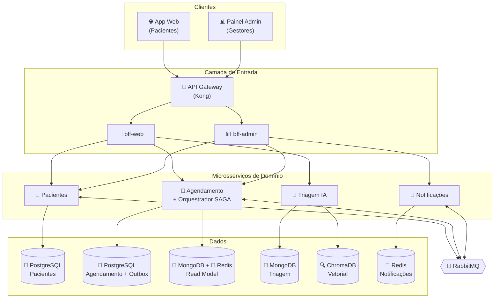
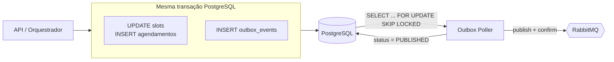
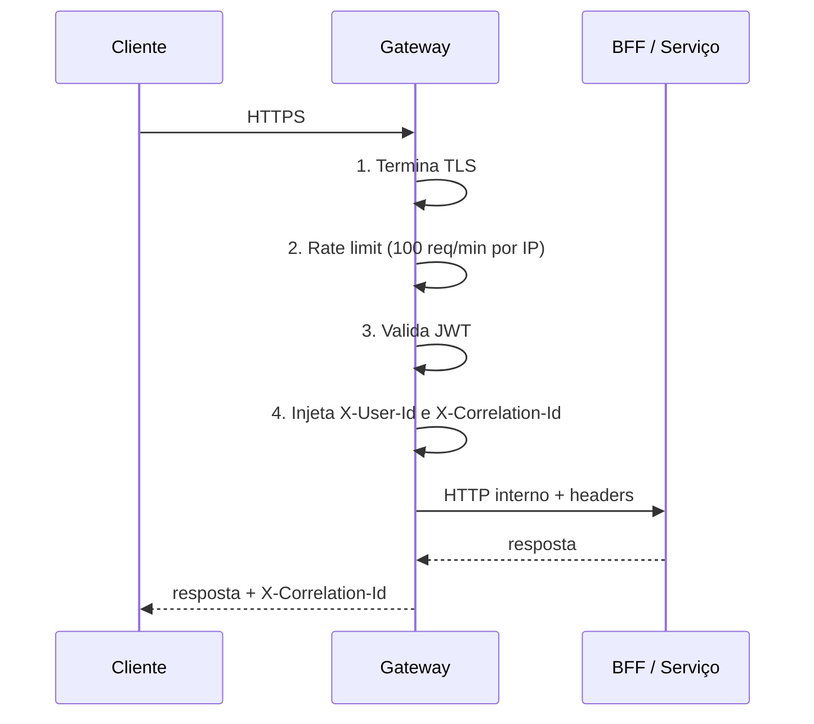
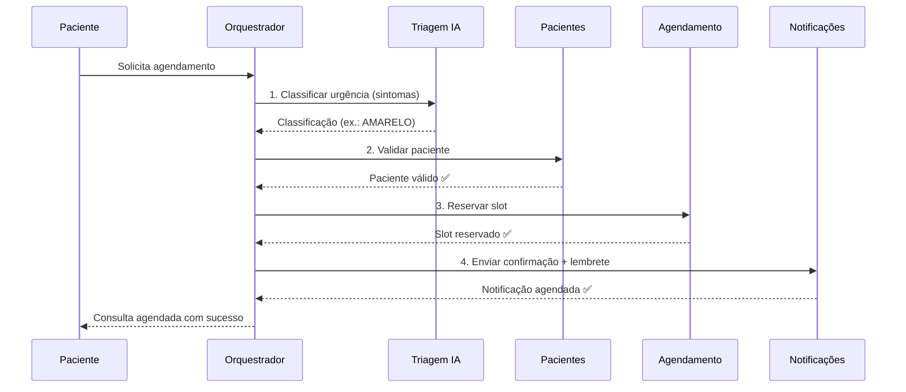
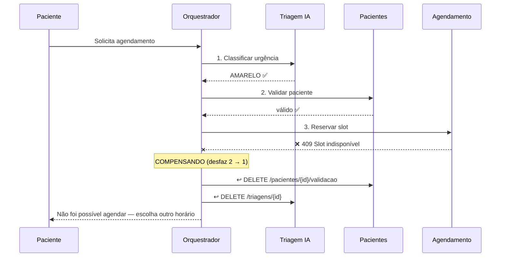
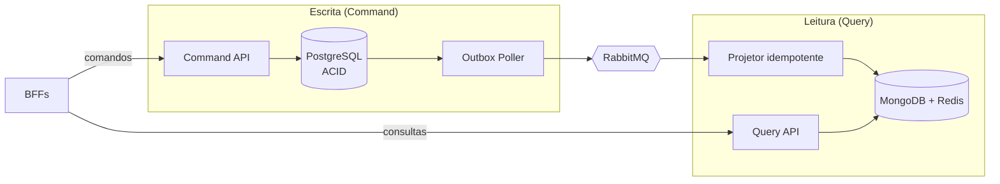

# 🏗️ Arquitetura — SaúdeConecta

[← README](README.md) · **Arquitetura** · [Documentação detalhada](docs/)

> Visão de arquitetura da **Parte 2** do trabalho. Este documento é o mapa; cada seção resume uma decisão e aponta para o documento que a detalha em [`docs/`](docs/).

---

## 🧭 Sumário

| # | Seção | Pergunta que responde |
|---|-------|-----------------------|
| 1 | [Visão geral](#1-visão-geral) | Como o sistema se organiza? |
| 2 | [Os 4 microsserviços](#2-os-4-microsserviços) | Por que este corte? |
| 3 | [Comunicação entre serviços](#3-comunicação-entre-serviços) | Quando REST, quando evento? |
| 4 | [Database per Service e Outbox](#4-database-per-service-e-outbox) | Como os dados ficam consistentes? |
| 5 | [API Gateway](#5-api-gateway) | Como o sistema é exposto com segurança? |
| 6 | [Backend for Frontend](#6-backend-for-frontend-2-bffs) | Por que dois BFFs? |
| 7 | [Contratos de API](#7-contratos-de-api) | Como os serviços são consumidos? |
| 8 | [SAGA orquestrada](#8-saga-orquestrada) | Como agendar atravessando 4 serviços? |
| 9 | [CQRS](#9-cqrs) | Como servir leituras rápidas sem arriscar a escrita? |
| 10 | [Padrões distribuídos — resumo](#10-padrões-distribuídos--resumo) | Que problema cada padrão resolve? |
| 11 | [Requisitos da Parte 2 × onde estão](#11-requisitos-da-parte-2--onde-estão) | Onde está cada entrega? |

---

## 1. Visão geral

Arquitetura de **microsserviços** com **Database per Service**, comunicação síncrona (REST) e assíncrona (RabbitMQ). Lendo de cima para baixo: clientes → Gateway → dois BFFs → quatro serviços de domínio → um banco por serviço.



> **Princípio central:** nenhum serviço lê o banco do outro. A integração acontece **só por API ou por evento**.

---

## 2. Os 4 microsserviços

| Serviço | Responsabilidade | Banco | Tipo de subdomínio |
|---------|------------------|-------|--------------------|
| **Pacientes** | Cadastro, autenticação, perfil, histórico | PostgreSQL | Suporte |
| **Agendamento** | Slots, reservas, disponibilidade, escalas; hospeda o orquestrador da SAGA | PostgreSQL (escrita) + MongoDB/Redis (leitura) | **Core** |
| **Triagem IA** | Classificação de urgência (LLM + RAG), orientação | MongoDB + ChromaDB | **Core** |
| **Notificações** | Lembretes, confirmações, alertas | Redis | Suporte |

**Por que este corte (DDD):**

1. **A linguagem muda de sentido entre contextos.** "Paciente" é cadastro com credenciais em *Pacientes*, só um `pacienteId` em *Agendamento*, idade + sintomas em *Triagem* e destinatário com canais em *Notificações*.
2. **A invariante crítica cabe em um banco.** "Um horário não pode ser reservado duas vezes" exige uma transação ACID, por isso **Slot e Agendamento ficam juntos**.
3. **Perfis de carga e de mudança diferentes.** Triagem muda por modelo/protocolo e consome CPU de LLM; Agendamento tem pico de manhã; Notificações chega em rajadas.

| Alternativa descartada | Motivo |
|------------------------|--------|
| Monólito modular | Não permite escala e stack independentes; acopla IA ao agendamento |
| Slot separado de Agendamento | Quebraria a regra anti-overbooking em duas transações |
| Triagem dentro de Agendamento | Ciclos de mudança e perfil de carga muito diferentes |
| Usuário + Paciente separados | Granularidade excessiva para o escopo |

📄 Detalhes: [`decomposicao-microsservicos.md`](docs/arquitetura/decomposicao-microsservicos.md) — bounded contexts, context map e diagrama de componentes.

---

## 3. Comunicação entre serviços

| Use | Quando | Exemplos |
|-----|--------|----------|
| **REST (síncrono)** | Quem chama precisa da resposta **agora** para continuar | BFF → serviços; orquestrador da SAGA → passos |
| **Evento no RabbitMQ (assíncrono)** | Algo **já aconteceu** e outros reagem sem o produtor esperar | `SlotReservado`, `AgendamentoCancelado`, `PacienteAtualizado` |

| Característica do RabbitMQ | Decisão |
|----------------------------|---------|
| Topologia | 1 *topic exchange* `saudeconecta.events` |
| Filas | Uma por consumidor, duráveis |
| Garantia | *At-least-once* → consumidores **idempotentes** |
| Falhas | Retry exponencial + DLQ |

> Se **Notificações** cair, o paciente continua agendando: o evento fica na fila até o serviço voltar.

---

## 4. Database per Service e Outbox

### 4.1 Um banco por serviço

Cada banco é uma **instância própria**, com volume e credenciais exclusivos. Mesmo onde a tecnologia se repete (PostgreSQL em Pacientes e Agendamento; MongoDB em Triagem e no Read Model), não há servidor compartilhado.

| Serviço | Tecnologia | Por quê |
|---------|-----------|---------|
| Pacientes | PostgreSQL | Integridade relacional e auditoria (LGPD) |
| Agendamento | PostgreSQL | ACID contra overbooking |
| Triagem IA | MongoDB + ChromaDB | Documentos flexíveis + busca vetorial (RAG) |
| Notificações | Redis | Agendamento por TTL, baixa latência |

### 4.2 Pontos de consistência eventual

| Origem → destino | Mecanismo | SLA (p95) |
|------------------|-----------|-----------|
| Agendamento → Read Model | `SlotReservado` via Outbox | **≤ 5 s** |
| Agendamento → Notificações | `AgendamentoCriado` | ≤ 30 s |
| Agendamento → Pacientes (histórico) | `AtendimentoRealizado` | ≤ 60 s |
| Pacientes → Agendamento (dados de exibição) | `PacienteAtualizado` | ≤ 60 s |

**O que nunca é eventual:** a decisão de reservar um slot, tomada sempre no modelo de escrita.

### 4.3 O problema: Dual Write

Salvar no banco e publicar no RabbitMQ são **dois passos sem transação comum**. Se o processo cai entre eles, o evento se perde; se publica antes do commit e o commit falha, sai um evento de algo que não aconteceu. Em ambos os casos, os dados divergem **silenciosamente**.

### 4.4 A solução: Transactional Outbox

O evento é gravado **na mesma transação** do dado, numa tabela `outbox_events`. Um worker lê a tabela e publica no RabbitMQ: ou os dois acontecem, ou nenhum.



| Aspecto | Decisão |
|---------|---------|
| Leitura concorrente | `FOR UPDATE SKIP LOCKED` → várias réplicas do poller sem duplicar publicação |
| Retry | Backoff exponencial; após 10 tentativas → `FAILED` + alerta |
| Entrega | *At-least-once*; consumidores deduplicam por `eventId` |
| Alternativa futura | CDC com Debezium |

📄 Detalhes: [`outbox-e-consistencia.md`](docs/decisoes-tecnicas/outbox-e-consistencia.md) — modos de falha, `CREATE TABLE outbox_events`, idempotência e métricas.

---

## 5. API Gateway

**Única porta de entrada** (Kong). Resolve as preocupações transversais uma vez, em vez de repeti-las em cada serviço.

| Rota externa | Destino |
|--------------|---------|
| `/web/v1/*` | `bff-web` (perfil `paciente`) |
| `/admin/v1/*` | `bff-admin` (perfil `gestor`) |
| `/api/v1/agendamentos`, `/slots`, `/escalas`, `/relatorios` | Agendamento |
| `/api/v1/pacientes/*`, `/auth/login` | Pacientes |
| `/api/v1/pacientes/{id}/preferencias-notificacao` | Notificações (rota por regex com prioridade) |
| `/api/v1/triagens/*` | Triagem IA |
| `/api/v1/notificacoes/*` | Notificações |



- O **rate limit vem antes do JWT** para proteger a validação criptográfica contra abuso.
- O `X-Correlation-Id` acompanha a requisição até os eventos do RabbitMQ: rastreio de ponta a ponta.

📄 Detalhes: [`gateway-routing.md`](docs/gateway-routing.md) — tabela de rotas completa, configuração do Kong, JWT e propagação de headers.

---

## 6. Backend for Frontend (2 BFFs)

| | `bff-web` (paciente) | `bff-admin` (gestor) |
|--|----------------------|----------------------|
| Escopo | Só os próprios dados | Todas as UBS da jurisdição |
| Formato | Enxuto, texto pronto, ações (`_links`) | Agregado, estatístico, séries |
| Serviços | Pacientes · Agendamento · Triagem | Pacientes · Agendamento · Notificações |
| Dados pessoais | Do próprio titular | **Nenhum** — só agregados anonimizados |
| Cache | 30 s | 5 min |

**Mesma entidade, duas respostas:**

```jsonc
// GET /web/v1/agendamentos/{id} — paciente
{ "status": "AGENDADO", "quando": "quarta, 05/11 às 09:30", "onde": "UBS Centro",
  "_links": { "confirmar": {...}, "reagendar": {...}, "cancelar": {...} } }

// GET /admin/v1/agendamentos/resumo?ubsId=...&periodo=2026-11 — gestor
{ "capacidade": { "ocupacaoPercentual": 87.5 }, "absenteismo": { "taxa": 7.4 },
  "porUrgencia": { "VERMELHO": 4, "AMARELO": 240 }, "alertas": [ { "tipo": "GARGALO" } ] }
```

**Por que não um BFF único:** risco de vazamento por um `if (role)` esquecido, deploys acoplados e escalas diferentes.

📄 Detalhes: [`bff-comparativo.md`](docs/bff-comparativo.md) — payloads completos e diff lado a lado.

---

## 7. Contratos de API

| Serviço | Contrato OpenAPI 3.0 |
|---------|----------------------|
| Pacientes | [`openapi-pacientes.yaml`](docs/api/openapi-pacientes.yaml) |
| Agendamento | [`openapi-agendamento.yaml`](docs/api/openapi-agendamento.yaml) |
| Triagem IA | [`openapi-triagem.yaml`](docs/api/openapi-triagem.yaml) |
| Notificações | [`openapi-notificacoes.yaml`](docs/api/openapi-notificacoes.yaml) |

- **Versionamento por URI** (`/api/v1/...`): visível, trivial de rotear no Gateway, versões coexistem; a anterior fica 90 dias em deprecação.
- **Erros** em RFC 7807 (`application/problem+json`); `202 Accepted` + `Location` quando o resultado depende da SAGA.
- **HATEOAS** em `GET /agendamentos/{id}`: os `_links` dependem do estado.

| Status | Links devolvidos |
|--------|------------------|
| `PENDENTE` | `self`, `cancelar` |
| `AGENDADO` | `self`, `confirmar`, `reagendar`, `cancelar` |
| `CONFIRMADO` | `self`, `reagendar`, `cancelar` |
| `CANCELADO` · `REALIZADO` · `FALTOU` | `self` |

> O cliente não precisa conhecer as regras de negócio: só segue os links.

📄 Detalhes: [`api-guidelines.md`](docs/decisoes-tecnicas/api-guidelines.md)

---

## 8. SAGA orquestrada

Agendar atravessa **4 serviços e 4 bancos**. Não há transação única: é uma sequência de transações locais, cada uma com sua **compensação**.

**Por que orquestrada e não coreografada:**

1. Os 4 passos têm **ordem obrigatória** (a urgência define o slot; o slot define a notificação).
2. A compensação precisa ser **completa e em ordem inversa**, sem risco de slot preso.
3. É preciso **auditar em qual passo falhou** (estado em `saga_instances`).

O orquestrador mora **dentro do serviço de Agendamento**, dono do processo, sem criar um quinto serviço.

<details open>
<summary>📖 SAGA — caminho feliz e cenário de falha</summary>

**Caminho feliz**



**Cenário de falha — slot tomado no passo 3**



**Compensações (todos os passos têm reversão)**

| Passo | Ação | Compensação |
|-------|------|-------------|
| 1. Triagem | Classificar urgência | `DELETE /triagens/{id}` — descartar classificação |
| 2. Pacientes | Validar e marcar "agendamento em andamento" | `DELETE /pacientes/{id}/validacao` — reverter flag |
| 3. Agendamento | Reservar slot | `DELETE /slots/{id}/reserva` — liberar slot |
| 4. Notificações | Agendar confirmação | `DELETE /notificacoes/{id}` — cancelar notificação |

</details>

> **Regra:** só se desfaz o que foi feito, na ordem contrária. Compensações são idempotentes; se esgotarem as tentativas, a SAGA vai para `COMPENSACAO_PENDENTE` e gera alerta.

📄 Detalhes: [`saga-agendamento.md`](docs/arquitetura/saga-agendamento.md) — comparativo completo, falha no passo 4 (cascata 3 → 2 → 1) e estados da SAGA.

---

## 9. CQRS

Aplicado ao serviço de **Agendamento**: muita gente consulta horários, pouca gente reserva (leitura ~20–50× maior). Separamos quem **decide** de quem **exibe**.



| | Escrita | Leitura |
|--|---------|---------|
| Banco | PostgreSQL normalizado | MongoDB (telas, dashboard) + Redis (slots livres) |
| Prioridade | Correção — índice único parcial torna o **overbooking impossível** | Latência e volume |
| Atualização | — | `SlotReservado` → Outbox → RabbitMQ → Projetor |

**Defasagem aceitável: ≤ 5 s (p95)**; esperado ≈ 0,4 s.

> **E se aparecer livre um horário já reservado?** A tentativa devolve `409` e a tela recarrega. É seguro porque **quem decide a reserva é a escrita, nunca a leitura**.

📄 Detalhes: [`cqrs-agendamento.md`](docs/arquitetura/cqrs-agendamento.md) — modelos, pipeline, orçamento de latência e monitoramento.

---

## 10. Padrões distribuídos — resumo

| Padrão | Problema que resolve | Documento |
|--------|---------------------|-----------|
| **Database per Service** | Autonomia dos serviços | [`decomposicao-microsservicos.md`](docs/arquitetura/decomposicao-microsservicos.md) |
| **Outbox** | Evento nunca se perde (sem dual write) | [`outbox-e-consistencia.md`](docs/decisoes-tecnicas/outbox-e-consistencia.md) |
| **API Gateway** | Entrada única e segura | [`gateway-routing.md`](docs/gateway-routing.md) |
| **2 BFFs** | Resposta sob medida para cada usuário | [`bff-comparativo.md`](docs/bff-comparativo.md) |
| **SAGA orquestrada** | Consistência entre serviços, com desfazer | [`saga-agendamento.md`](docs/arquitetura/saga-agendamento.md) |
| **CQRS** | Leitura rápida, defasagem ≤ 5 s | [`cqrs-agendamento.md`](docs/arquitetura/cqrs-agendamento.md) |

> **O Outbox garante o evento, a SAGA garante o processo, o CQRS garante a leitura rápida.**

---

## 11. Requisitos da Parte 2 × onde estão

| Requisito do enunciado | Onde está |
|------------------------|-----------|
| 4.1 Serviços, fronteiras, diagramas de componentes e comunicação | [§2](#2-os-4-microsserviços), [§3](#3-comunicação-entre-serviços) · [`decomposicao-microsservicos.md`](docs/arquitetura/decomposicao-microsservicos.md) |
| 4.2 Contratos, verbos/status, versionamento, HATEOAS | [§7](#7-contratos-de-api) · [`docs/api/`](docs/api/) · [`api-guidelines.md`](docs/decisoes-tecnicas/api-guidelines.md) |
| 4.3 Gateway, roteamento e responsabilidades | [§5](#5-api-gateway) · [`gateway-routing.md`](docs/gateway-routing.md) |
| 4.4 2 BFFs e diferença de respostas | [§6](#6-backend-for-frontend-2-bffs) · [`bff-comparativo.md`](docs/bff-comparativo.md) |
| 4.5 Banco por serviço, consistência eventual, dual write, outbox | [§4](#4-database-per-service-e-outbox) · [`outbox-e-consistencia.md`](docs/decisoes-tecnicas/outbox-e-consistencia.md) |
| 4.6 SAGA: variante justificada, 3+ serviços, compensações, diagramas | [§8](#8-saga-orquestrada) · [`saga-agendamento.md`](docs/arquitetura/saga-agendamento.md) |
| 4.7 CQRS: separação, justificativa, atualização e defasagem | [§9](#9-cqrs) · [`cqrs-agendamento.md`](docs/arquitetura/cqrs-agendamento.md) |
