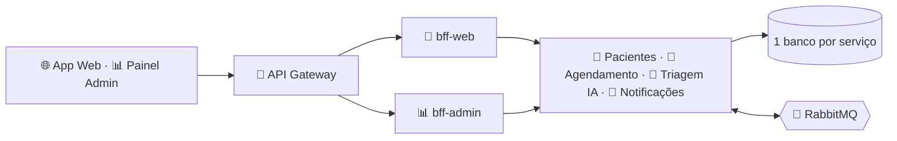

# 🏥 SaúdeConecta

> *Conectando comunidades à saúde que precisam*

`GCC129 — Sistemas Distribuídos` · `UFLA · 2026/2` · `Parte 4 — Sistema em Funcionamento`

**[📖 Visão geral](#-visão-geral)** · **[🏗️ Arquitetura](ARCHITECTURE.md)** · **[📂 Documentação](docs/)** · **[🚀 Como executar](#-como-executar)** · **[🎬 Demonstração](docs/demonstracao.md)**

**Repositório:** [github.com/multiheros/saude-conecta](https://github.com/multiheros/saude-conecta)

---

## 🧭 Sumário

| # | Seção |
|---|-------|
| 1 | [Visão Geral](#-visão-geral) |
| 2 | [Equipe](#-equipe) |
| 3 | [O Problema](#-o-problema) |
| 4 | [O Problema em Números](#-o-problema-em-números) |
| 5 | [Fundamentação](#-fundamentação) |
| 6 | [Impacto Social](#-impacto-social) |
| 7 | [A Solução](#-a-solução) |
| 8 | [Arquitetura](#️-arquitetura) → completa em [`ARCHITECTURE.md`](ARCHITECTURE.md) |
| 9 | [Como Executar](#-como-executar) |
| 10 | [Status das Etapas](#-status-das-etapas) |
| 11 | [Governança Git](#-governança-git) |
| 12 | [Documentação](#-documentação) |
| 13 | [Referências](#-referências) |

---

## ⚡ Visão Geral

- **O que é:** plataforma de agendamento digital e triagem assistida por IA para Unidades Básicas de Saúde (UBS) do SUS.
- **Para quem:** pacientes da Atenção Primária e gestores municipais de saúde.
- **Diferencial:** triagem de urgência com **LLM + RAG** sobre protocolos médicos oficiais, em uma arquitetura de **4 microsserviços** com **SAGA** e **CQRS**.

---

## 👥 Equipe

| Nome | GitHub |
|------|--------|
| Jonathan Nascimento Carvalho | [@multiheros](https://github.com/multiheros) |
| Maria Lina da Silva | [@Marialinaa](https://github.com/Marialinaa) |
| Matheus Gomes | [@MatheusssGM](https://github.com/MatheusssGM) |

---

## 🎯 O Problema

> **Por que, em pleno século 21, milhões de brasileiros ainda enfrentam filas de madrugada apenas para marcar uma consulta no posto de saúde?**

- **93,8% das UBS** ainda realizam agendamento **presencial** — o paciente se desloca até a unidade apenas para tentar pegar um horário *(Censo UBS 2024 — RESBR/MS)*.
- **57 dias** é o tempo médio de espera por consulta especializada, ultrapassando **150 dias** em algumas regiões *(APM/CFM, 2024)*.
- **20% a 30%** dos pacientes **faltam** às consultas agendadas — cada falta é um horário desperdiçado que poderia atender outra pessoa.
- **Desigualdade no acesso:** quem depende exclusivamente do SUS enfrenta as maiores barreiras, que variam por renda, escolaridade e região *(IBGE — PNS 2019)*.

<details>
<summary>📖 Contexto completo</summary>

O Sistema Único de Saúde (SUS) é o maior sistema de saúde pública do mundo, atendendo **mais de 150 milhões de brasileiros** que dependem exclusivamente da rede pública. Apesar dos avanços reconhecidos internacionalmente, a **Atenção Primária à Saúde (APS)** — porta de entrada do SUS — enfrenta problemas crônicos que comprometem o acesso efetivo da população:

- **Filas e tempo de espera excessivos:** o tempo médio de espera para consulta especializada no SUS é de aproximadamente **57 dias**, com disparidades regionais que ultrapassam **150 dias** em algumas áreas (APM, 2024).
- **Absenteísmo elevado:** entre **20% e 30%** dos pacientes faltam às consultas agendadas em UBS, desperdiçando recursos escassos e aumentando filas para outros pacientes.
- **Agendamento predominantemente presencial:** o Censo das UBS 2024 revelou que **93,8% das unidades** ainda realizam agendamentos de forma presencial, exigindo que o paciente se desloque até a unidade apenas para marcar uma consulta.
- **Triagem ineficiente:** a classificação de risco é frequentemente feita de forma subjetiva ou não é realizada, levando pacientes urgentes a esperarem junto com casos eletivos.
- **Desigualdade regional:** a cobertura da Estratégia Saúde da Família apresenta enormes disparidades regionais, com comunidades periféricas e rurais enfrentando as maiores barreiras de acesso.

</details>

---

## 📊 O Problema em Números

| Indicador | Valor | Fonte |
|-----------|-------|-------|
| Agendamento ainda 100% presencial nas UBS | **93,8%** | Censo UBS 2024 (RESBR/MS) |
| Tempo médio de espera por especialista | **57 dias** | APM/CFM, 2024 |
| Espera em regiões mais críticas | **150+ dias** | APM/CFM, 2024 |
| Taxa de faltas em consultas agendadas | **20–30%** | Ciência & Saúde Coletiva |
| Cobertura da Estratégia Saúde da Família | **76%** (com forte desigualdade regional) | IBGE, 2023 |

> **Cada falta é uma consulta desperdiçada para outra pessoa.**

---

## 📚 Fundamentação

> Nossa proposta não é baseada em achismos.

| # | Referência | O que sustenta |
|---|-----------|----------------|
| 1 | **Paim et al. (2011)** — *The Lancet* | Desigualdades regionais persistem na atenção primária |
| 2 | **IBGE — PNS 2019** | Acesso varia conforme renda, escolaridade e região |
| 3 | **Censo UBS 2024 (RESBR/MS)** | 93,8% das UBS agendam presencialmente |
| 4 | **Giovanella et al. (2009)** — *Ciência & Saúde Coletiva* | Limites da Saúde da Família como atenção integral |

<details>
<summary>📖 Referências complementares</summary>

- **APM/CFM (2024)** — dados sobre tempo de espera para consultas especializadas no SUS.
- **OMS/OPAS (2023)** — relatórios sobre cobertura de saúde nas Américas.
- **CGI.br (2024)** — TIC Saúde 2024.

Lista completa e formatada em [Referências](#-referências).

</details>

---

## 🌍 Impacto Social

### Quem é beneficiado

| Grupo | Como é beneficiado |
|-------|-------------------|
| **Famílias de baixa renda** | Agendamento sem filas presenciais; deixam de perder diárias de trabalho só para tentar marcar consulta |
| **Idosos e mães com filhos pequenos** | Não precisam mais se deslocar até a UBS apenas para agendar |
| **Profissionais de saúde** | Agenda mais organizada, triagem prévia e menos "furos" por absenteísmo |
| **Gestores municipais** | Dados em tempo real para alocação de recursos e identificação de gargalos |
| **O SUS como sistema** | Redução do desperdício e melhor cobertura efetiva |

### Como medir

| Métrica | Linha de base | Meta |
|---------|--------------|------|
| Tempo para agendar consulta | Meia jornada (presencial) | **< 5 minutos** (digital) |
| Taxa de absenteísmo | 20–30% | **redução de 30–50%** |
| Adequação da triagem | Subjetiva / não realizada | **> 85%** de concordância com o médico |
| Cobertura de agendamento digital | ~6% | **crescimento progressivo** pela plataforma |
| Satisfação do usuário | — | **NPS** dos pacientes |

<details>
<summary>📖 Teoria da mudança</summary>

```
Agendamento digital + Triagem com IA + Lembretes automáticos + Dashboard para gestores
        ↓                    ↓                     ↓                      ↓
Eliminação de filas   Priorização        Redução do            Dados para
 para marcar          objetiva por       absenteísmo           decisão
                      urgência
        ↓                    ↓                     ↓                      ↓
                    MELHOR ACESSO À SAÚDE PRIMÁRIA
                              ↓
              REDUÇÃO DAS DESIGUALDADES NO ACESSO AO SUS
```

</details>

---

## 💡 A Solução

O **SaúdeConecta** é uma plataforma de **agendamento inteligente e triagem assistida por IA** para UBS, com dois clientes distintos.

### 📱 Para o Paciente

- Agendamento digital com visualização de disponibilidade em tempo real.
- **Triagem inteligente:** descreve os sintomas e o sistema classifica a urgência com base em protocolos médicos (IA + RAG).
- Lembretes automáticos e orientação pré-consulta.
- Histórico simplificado de atendimentos.

### 📊 Para o Gestor de Saúde

- Dashboard de **ocupação em tempo real** (agendado vs. capacidade).
- Métricas de demanda por região, especialidade e período.
- Gestão de escalas e relatórios de absenteísmo.
- **Alertas de gargalo** quando a demanda supera a capacidade.

### 🛠️ Stack Tecnológica

| Camada | Tecnologia |
|--------|-----------|
| Serviços de domínio | Python (FastAPI) + Node.js (Express) |
| Bancos de dados | PostgreSQL · MongoDB · Redis · ChromaDB |
| Mensageria | RabbitMQ (topic exchange + DLQ) |
| IA | LLM (DeepSeek Flash; Gemini como alternativa) + RAG (LangChain + ChromaDB, embeddings locais) |
| API Gateway / BFFs | Kong + 2 BFFs (web e admin) |
| Frontends | React (app do paciente + painel do gestor) |
| Infra | Docker + Docker Compose + Kubernetes |

---

## 🏗️ Arquitetura

> 📐 **A arquitetura completa está em [`ARCHITECTURE.md`](ARCHITECTURE.md)**: decomposição, comunicação, Outbox, Gateway, BFFs, contratos, SAGA e CQRS, cada um com seu diagrama e o link para o documento detalhado.

Arquitetura de **microsserviços** com **Database per Service**, comunicação síncrona (REST) e assíncrona (RabbitMQ).



| Serviço | Responsabilidade | Banco |
|---------|------------------|-------|
| **Pacientes** | Cadastro, autenticação, perfil, histórico | PostgreSQL |
| **Agendamento** | Slots, reservas, disponibilidade, escalas | PostgreSQL + Read Model (MongoDB/Redis) |
| **Triagem IA** | Classificação de urgência (LLM + RAG), orientação | MongoDB + ChromaDB |
| **Notificações** | Lembretes, confirmações, alertas | Redis |

| Padrão | Problema que resolve | Na arquitetura |
|--------|---------------------|----------------|
| Database per Service | Autonomia dos serviços | [§4](ARCHITECTURE.md#4-database-per-service-e-outbox) |
| Outbox | Evento nunca se perde | [§4](ARCHITECTURE.md#4-database-per-service-e-outbox) |
| API Gateway | Entrada única e segura | [§5](ARCHITECTURE.md#5-api-gateway) |
| 2 BFFs | Resposta sob medida para cada usuário | [§6](ARCHITECTURE.md#6-backend-for-frontend-2-bffs) |
| SAGA orquestrada | Consistência entre serviços, com desfazer | [§8](ARCHITECTURE.md#8-saga-orquestrada) |
| CQRS | Leitura rápida, defasagem ≤ 5 s | [§9](ARCHITECTURE.md#9-cqrs) |

---

## 🚀 Como Executar

**Requisitos:** Docker 24+ com Compose v2, Bash e 4 GB de memória livre (a stack ocupa cerca de 1,7 GB em repouso e mais 1 GB enquanto carrega a base do RAG). Para Kubernetes: `kubectl` e [`kind`](https://kind.sigs.k8s.io). Nada mais precisa ser instalado: testes e ferramentas rodam em containers.

### Docker Compose (um comando)

```bash
docker compose up -d --build
```

Para subir depois sem internet e sem depender do Docker Hub: `scripts/preparar.sh` uma vez e, dali em diante, `docker compose up -d --no-build`.

Para usar o LLM na triagem, copie `.env.example` para `.env` e preencha `DEEPSEEK_API_KEY` (ou `GEMINI_API_KEY`) antes de subir. Sem chave, a triagem funciona por regras.

Entrada única pelo gateway:

| Cliente | Endereço | Acesso fictício |
|---------|----------|-----------------|
| App do paciente | http://localhost:8080 | CPF `10000000108`, senha `demo12345` |
| Painel do gestor | http://localhost:8080/painel | CPF `90000000175`, senha `demo12345` |

```bash
scripts/demo/dados.sh   # opcional: enche a agenda com dados fictícios, pela API real
```

Pela linha de comando:

```bash
# Paciente fictício 10000000108; gestora 90000000175 (troque o CPF e a rota)
TOKEN=$(curl -s http://localhost:8080/api/v1/auth/login -H 'content-type: application/json' \
     -d '{"cpf":"10000000108","senha":"demo12345"}' | sed 's/.*accessToken":"\([^"]*\).*/\1/')
curl -H "Authorization: Bearer $TOKEN" http://localhost:8080/web/v1/home        # BFF do paciente
# BFF do gestor: http://localhost:8080/admin/v1/unidades, com o token da gestora
```

```bash
docker compose down        # para (mantém os volumes)
docker compose down -v     # para e apaga os volumes
```

### Kubernetes (kind)

```bash
scripts/k8s-subir.sh     # cluster kind, Ingress, imagens, chaves e manifestos; http://localhost:8081
```

Com um comando: cria o cluster se não existir, constrói e carrega as imagens, gera as chaves do JWT e espera tudo ficar pronto. Se houver `DEEPSEEK_API_KEY` ou `GEMINI_API_KEY` no `.env`, cria o Secret do LLM. `CLUSTER=` e `PORTA=` mudam o nome e a porta.

### Provas

```bash
scripts/e2e.sh          # todas, com resumo: testes, isolamento, Outbox, SAGA, CQRS, RAG, LLM, gateway, telas, offline (~18 min)
scripts/demo/5-falha.sh # uma cena da demonstração: SAGA com falha e compensação
```

As cenas e o plano B estão em [`docs/demonstracao.md`](docs/demonstracao.md).

### Limpeza

`kind delete cluster --name saudeconecta`; `docker compose down -v`. Detalhes de redes, volumes, imagens e manifestos em [`docs/containerizacao.md`](docs/containerizacao.md).

---

## 🗺️ Status das Etapas

| Etapa | Status | Data |
|-------|--------|------|
| **Parte 1** — Concepção e Pitch | 🟢 Concluída | 17/09/2026 |
| **Parte 2** — Arquitetura | 🟢 Concluída | 22–27/10/2026 |
| **Parte 3** — Containerização e K8s ([vídeo](https://youtu.be/KnB0XyP8xoM) · [apresentação em PDF](docs/apresentacao-parte3.pdf)) | 🟢 Concluída | 17/11/2026 |
| **Parte 4** — Sistema em Funcionamento | 🟡 Pronta para apresentação | 10–15/12/2026 |

---

## 🔀 Governança Git

- Desenvolvimento em **branches por funcionalidade** (`feat/`, `fix/`, `docs/`, `infra/`, `test/`, `refactor/`).
- Integração **somente via Pull Request** com **1 review aprovado** de outro integrante.
- **`main` protegida:** sem push direto e sem auto-aprovação.
- Trabalho em par registrado com `Co-authored-by:`.
- Commits distribuídos ao longo do semestre.

---

## 📂 Documentação

| Documento | Descrição |
|-----------|-----------|
| [`ARCHITECTURE.md`](ARCHITECTURE.md) | **Visão de arquitetura** — ponto de partida; requisitos das Partes 2 e 4 e onde estão |
| [`docs/containerizacao.md`](docs/containerizacao.md) | Imagens, redes, volumes, Kubernetes e provas *(Partes 3 e 4)* |
| [`docs/apresentacao-parte3.pdf`](docs/apresentacao-parte3.pdf) | Apresentação da Parte 3: roteiro do vídeo com prints dos comandos, no código da etapa (commit `a954388`) *(Parte 3)* |
| [`docs/parte1_concepcao.md`](docs/parte1_concepcao.md) | Concepção, problema, impacto social e referências (Parte 1) |
| [`docs/arquitetura/decomposicao-microsservicos.md`](docs/arquitetura/decomposicao-microsservicos.md) | Bounded Contexts (DDD), componentes e comunicação REST/RabbitMQ *(Parte 2)* |
| [`docs/arquitetura/saga-agendamento.md`](docs/arquitetura/saga-agendamento.md) | SAGA orquestrada e fluxo compensatório *(Parte 2)* |
| [`docs/arquitetura/cqrs-agendamento.md`](docs/arquitetura/cqrs-agendamento.md) | CQRS: Write/Read Model e sincronização ≤ 5s *(Parte 2)* |
| [`docs/gateway-routing.md`](docs/gateway-routing.md) | Rotas e políticas do API Gateway *(Parte 2)* |
| [`docs/bff-comparativo.md`](docs/bff-comparativo.md) | Justificativa dos 2 BFFs e comparativo de payloads *(Parte 2)* |
| [`docs/api/`](docs/api/) | Contratos OpenAPI dos 4 serviços *(Parte 2)* |
| [`docs/decisoes-tecnicas/api-guidelines.md`](docs/decisoes-tecnicas/api-guidelines.md) | Versionamento por URI e HATEOAS *(Parte 2)* |
| [`docs/decisoes-tecnicas/outbox-e-consistencia.md`](docs/decisoes-tecnicas/outbox-e-consistencia.md) | Consistência eventual, Dual Write e Transactional Outbox *(Parte 2)* |
| [`docs/demonstracao.md`](docs/demonstracao.md) | Cenas da demonstração, preparo e plano B *(Parte 4)* |
| [`docs/clientes.md`](docs/clientes.md) | App do paciente e painel do gestor *(Parte 4)* |
| [`docs/arquitetura/rag-triagem.md`](docs/arquitetura/rag-triagem.md) | RAG da Triagem: base, embeddings, ChromaDB e recuperação *(Parte 4)* |
| [`docs/arquitetura/llm-triagem.md`](docs/arquitetura/llm-triagem.md) | LLM da Triagem: chains, tool, resiliência e privacidade *(Parte 4)* |
| [`docs/rag-avaliacao.md`](docs/rag-avaliacao.md) | Avaliação do RAG: 12 perguntas, com e sem recuperação *(Parte 4)* |
| [`docs/llm-latencia-custo.md`](docs/llm-latencia-custo.md) | Latência e custo do LLM, medidos *(Parte 4)* |

---

## 📚 Referências

### Base acadêmica e institucional

1. **PAIM, J. et al.** (2011). "The Brazilian health system: history, advances, and challenges." *The Lancet*, 377(9779), 1778-1797. DOI: [10.1016/S0140-6736(11)60054-8](https://doi.org/10.1016/S0140-6736(11)60054-8)
2. **IBGE** (2020). *Pesquisa Nacional de Saúde 2019: Informações sobre domicílios, acesso e utilização dos serviços de saúde.* Rio de Janeiro: IBGE. Disponível em: [ibge.gov.br](https://www.ibge.gov.br/estatisticas/sociais/saude/9160-pesquisa-nacional-de-saude.html)
3. **Ministério da Saúde / RESBR** (2024). *Censo das Unidades Básicas de Saúde 2024.* Rede de Pesquisa em APS. Disponível em: [resbr.net.br](https://resbr.net.br)
4. **GIOVANELLA, L. et al.** (2009). "Saúde da família: limites e possibilidades para uma abordagem integral de atenção primária à saúde no Brasil." *Ciência & Saúde Coletiva*, 14(3), 783-794. DOI: [10.1590/S1413-81232009000300014](https://doi.org/10.1590/S1413-81232009000300014)

### Complementares

5. **CFM / APM** (2024). Dados sobre tempo de espera para consultas especializadas no SUS. *Conselho Federal de Medicina / Associação Paulista de Medicina.*
6. **OMS/OPAS** (2023). Relatórios sobre cobertura de saúde nas Américas.

### Base de conhecimento da triagem

7. **BRASIL. Ministério da Saúde** (2013). *Acolhimento à demanda espontânea.* Cadernos de Atenção Básica, n. 28, v. I. Brasília. [PDF](https://bvsms.saude.gov.br/bvs/publicacoes/acolhimento_demanda_espontanea_cab28v1.pdf)
8. **BRASIL. Ministério da Saúde** (2013). *Acolhimento à demanda espontânea: queixas mais comuns na Atenção Básica.* Cadernos de Atenção Básica, n. 28, v. II. Brasília. [PDF](https://bvsms.saude.gov.br/bvs/publicacoes/acolhimento_demanda_espontanea_queixas_comuns_cab28v2.pdf)

---

*GCC129 — Sistemas Distribuídos — UFLA — 2026/2*
