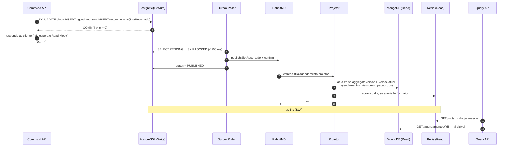

# 🔀 CQRS — Serviço de Agendamento

> O README resume: "escrita normalizada separada da leitura desnormalizada (defasagem aceitável ≤ 5 s)". Aqui estão a **justificativa**, a **modelagem** dos dois lados e o **pipeline de sincronização**.

## 1. Por que CQRS no Agendamento?

**CQRS** separa o modelo que **altera** estado (*Command / Write*) do que **consulta** (*Query / Read*).

O serviço de Agendamento tem dois perfis opostos:

| | Escrita (Command) | Leitura (Query) |
|--|-------------------|-----------------|
| Operações | Reservar, cancelar, reagendar, confirmar | Listar slots livres, ver agendamento, dashboard |
| Prioridade | **Correção** (sem overbooking) | **Latência e volume** |
| Volume | Baixo/médio | **~20–50× maior** (cada paciente consulta muito antes de agendar; gestores recarregam painéis) |
| Formato ideal | Normalizado, constraints, ACID | Desnormalizado, pronto para a tela |
| Consultas | Por chave | Filtros e agregações (UBS × especialidade × período) |
| Escala | Vertical/poucas réplicas | Horizontal (réplicas de leitura/cache) |

| Problema sem CQRS | Como o CQRS resolve |
|-------------------|---------------------|
| `JOIN`s e agregações do dashboard competem com transações de reserva no mesmo PostgreSQL | Leituras vão ao Read Model; o Write Model só trata comandos |
| Modelo normalizado é ruim para telas (muitos joins) | Documentos já "achatados" |
| Pico de leitura derruba a escrita | Escalam independentemente |
| Índices otimizados para leitura **atrasam** a escrita | Cada lado indexa para o seu uso |
| `bff-admin` precisa de agregados (ocupação, absenteísmo) | Read Model já mantém contadores |

**Quando NÃO usaríamos CQRS:** CRUD simples, baixa leitura. Aqui se justifica pelo desbalanceamento leitura/escrita e pela necessidade de agregados para o gestor.

**Custo aceito:** consistência eventual (≤ 5 s) e mais um componente (projetor). Mitigado: a **decisão de reservar nunca usa o Read Model**.

## 2. Arquitetura

```mermaid
flowchart LR
    BFF["bff-web / bff-admin"]

    subgraph CMD["Lado de Escrita (Command)"]
      CAPI["Command API<br/>POST /agendamentos/..., /escalas"]
      WM[("PostgreSQL — Write Model<br/>ACID<br/>slots · agendamentos · saga_instances · outbox_events")]
      POLL["Outbox Poller"]
    end

    MQ{{"RabbitMQ"}}

    subgraph QRY["Lado de Leitura (Query)"]
      PROJ["Projetor / Consumidor<br/>(idempotente)"]
      RM[("Read Model<br/>MongoDB + Redis")]
      QAPI["Query API<br/>GET /slots, /agendamentos/..."]
    end

    BFF -- comandos --> CAPI --> WM
    WM --> POLL --> MQ --> PROJ --> RM
    BFF -- consultas --> QAPI --> RM
```



## 3. Write Model — PostgreSQL (ACID)

Fonte da verdade, normalizado (3FN), com constraints que garantem as invariantes.

```sql
CREATE TABLE ubs (id UUID PRIMARY KEY, nome ..., endereco ..., regiao ...);
CREATE TABLE profissionais (id UUID PRIMARY KEY, nome ..., especialidade ...);

CREATE TABLE slots (
    id              UUID PRIMARY KEY DEFAULT gen_random_uuid(),
    ubs_id          UUID NOT NULL REFERENCES ubs(id),
    profissional_id UUID NOT NULL REFERENCES profissionais(id),
    especialidade   VARCHAR(64) NOT NULL,
    inicio          TIMESTAMPTZ NOT NULL,
    fim             TIMESTAMPTZ NOT NULL,
    status          VARCHAR(12) NOT NULL DEFAULT 'LIVRE'
                    CHECK (status IN ('LIVRE','RESERVADO','BLOQUEADO')),
    version         INTEGER NOT NULL DEFAULT 0,        -- ordena os eventos da vaga
    -- o mesmo profissional não atende em horários sobrepostos
    EXCLUDE USING gist (profissional_id WITH =, tstzrange(inicio, fim) WITH &&)
);

CREATE TABLE agendamentos (
    id            UUID PRIMARY KEY,
    paciente_id   UUID NOT NULL,                       -- referência lógica (sem FK entre serviços)
    slot_id       UUID NOT NULL REFERENCES slots(id),
    status        VARCHAR(12) NOT NULL,
    urgencia      VARCHAR(8),
    motivo        VARCHAR(200),                        -- por que foi cancelado
    saga_id       UUID UNIQUE,
    version       INTEGER NOT NULL DEFAULT 1,          -- ordena os eventos do agendamento
    criado_em     TIMESTAMPTZ NOT NULL DEFAULT now(),
    atualizado_em TIMESTAMPTZ NOT NULL DEFAULT now()
);

-- Invariante anti-overbooking garantida pelo BANCO:
CREATE UNIQUE INDEX uq_slot_agendamento_ativo
    ON agendamentos (slot_id)
    WHERE status IN ('PENDENTE','AGENDADO','CONFIRMADO');
```

Esquema completo: [`services/agendamento/migrations`](../../services/agendamento/migrations).

Reserva = `UPDATE slots SET status='RESERVADO', version=version+1 WHERE id=:id AND status='LIVRE' AND inicio > now()` (0 linhas → `409`) + `INSERT` em `agendamentos` + `INSERT` em `outbox_events`, **numa transação** (ver [`outbox-e-consistencia.md`](../decisoes-tecnicas/outbox-e-consistencia.md)).

## 4. Read Model — MongoDB + Redis

Cada store atende a um padrão de consulta:

| Store | Conteúdo | Padrão | Por quê |
|-------|----------|--------|---------|
| **MongoDB** `agendamentos_view` | Documento do agendamento já "achatado" (+ UBS, profissional, texto de exibição) | `GET /agendamentos/{id}`, listagens, filtros | Documento único por tela, sem joins |
| **MongoDB** `ocupacao_ubs` | Um documento por UBS × especialidade × dia, com as vagas do dia e os contadores | Dashboard do gestor; carga do cache | Agregado pré-calculado |
| **Redis** `slots:{ubs}` (hash, campo `{espec}\|{dia}`, TTL 60 s) | Vagas livres de cada dia | `GET /slots` (hot path) | Uma ida ao cache por consulta |
| **MongoDB** `pacientes_view` | Nome do paciente (réplica de exibição, via `PacienteAtualizado`) | Preenche `agendamentos_view` | O nome pertence a Pacientes |

**Por que não `$inc`:** um evento repetido contaria a mesma reserva duas vezes. O documento do dia guarda cada vaga com a sua versão, e os contadores são recalculados na mesma atualização, que é atômica por ser um documento só. Aplicar o evento de novo, ou fora de ordem, não muda o resultado.

**Ordem no Redis:** cada campo leva uma revisão (`rev`, soma das versões das vagas do dia) e só é trocado por uma revisão maior (script Lua). Uma consulta lenta que leu o MongoDB antes não apaga a atualização que chegou depois.

```jsonc
// agendamentos_view
{
  "_id": "3fa85f64-...",
  "status": "AGENDADO",
  "paciente": { "id": "7c9e...", "nome": "Maria da Silva", "versao": 3 },   // cópia de exibição
  "slot": { "id": "9b2d...", "inicio": "2026-11-05T09:30:00-03:00" },
  "ubs": { "id": "a1b2...", "nome": "UBS Centro" },
  "profissional": { "nome": "Dra. Ana Souza", "especialidade": "Clínica Geral" },
  "urgencia": "AMARELO",
  "versao": 3,                       // versão do agregado: descarta repetidos e fora de ordem
  "ultimoEventoId": "e5c1...",       // rastreio
  "criadoEm": "2026-11-05T09:59:40Z",
  "atualizadoEm": "2026-11-05T10:00:03.100Z",   // gravação no PostgreSQL
  "projetadoEm": "2026-11-05T10:00:03.480Z"     // chegada ao Read Model
}
```

> `GET /sagas/{id}` é auditoria da orquestração e continua lendo o PostgreSQL; todas as outras consultas usam só o Read Model.
>
> **Descartável e reconstruível:** se o MongoDB volta vazio, o serviço o reconstrói sozinho a partir do PostgreSQL. Para apagar e refazer à mão: `docker compose exec agendamento node reprojetar.js`. As duas formas rodam com o sistema no ar, porque a versão protege contra sobrescrever um evento mais novo. Os nomes que faltarem são pedidos ao serviço de Pacientes.

## 5. Pipeline de sincronização assíncrona



### 5.1 Eventos que alimentam o Read Model

| Evento | Efeito na projeção |
|--------|-------------------|
| `AgendamentoSolicitado` | Cria `agendamentos_view` em `PENDENTE` |
| `SlotReservado` | Vaga do dia vira `RESERVADO`; contadores e cache recalculados |
| `SlotLiberado` | Vaga do dia volta a `LIVRE`; idem |
| `AgendamentoCriado` | `status = AGENDADO`, com urgência |
| `AgendamentoConfirmado` | `status = CONFIRMADO` |
| `AgendamentoReagendado` | Troca o horário do agendamento (os slots vêm em `SlotLiberado` + `SlotReservado`) |
| `AgendamentoCancelado` | `status = CANCELADO`, com `motivo` |
| `AtendimentoRealizado` / `FaltaRegistrada` | Atualiza status e absenteísmo |
| `EscalaCriada` | Carrega novos slots livres |
| `PacienteAtualizado` (de Pacientes) | Nome de exibição em `pacientes_view` e nos agendamentos do paciente |

> Cada evento altera **uma** coisa: contadores de vaga só mudam em `SlotReservado`/`SlotLiberado`, e status só nos eventos `Agendamento*`. Assim um cancelamento não devolve a mesma vaga duas vezes.

### 5.2 Orçamento de latência — SLA ≤ 5 s (p95)

| Etapa | Alvo | Máx. |
|-------|------|------|
| COMMIT → poller enxerga evento | ~250 ms | 500 ms (intervalo de polling) |
| Publicação + confirm no RabbitMQ | ~20 ms | 100 ms |
| Fila → projetor | ~50 ms | 500 ms |
| Upsert Mongo + Redis | ~50 ms | 300 ms |
| **Total esperado** | **~0,4 s** | |
| **Margem para retries/picos** | | **SLA fixado: ≤ 5 s** |

**Defasagem aceitável fixada: ≤ 5 segundos (p95); p99 ≤ 15 s; teto absoluto de alarme 30 s.**

### 5.3 Garantias e tratamento de falhas

| Cenário | Tratamento |
|---------|-----------|
| Evento duplicado (*at-least-once*) | `aggregateVersion` igual à atual: não muda nada. Dispensa tabela de eventos processados |
| Evento fora de ordem | `aggregateVersion`: aplica só se maior que a versão atual; senão descarta |
| Projetor fora do ar | Mensagens acumulam na fila durável; ao voltar, drena (lag sobe, alerta) |
| Duas réplicas consumindo a mesma fila | Podem inverter a ordem; a versão resolve |
| Parada entre MongoDB e Redis | A mensagem é reentregue; o cache é regravado mesmo sem mudança no MongoDB |
| MongoDB fora | O projetor insiste sem gastar tentativas; a fila acumula. Consultas respondem `503`; comandos e SAGA continuam |
| Redis fora | Projeção e consultas seguem pelo MongoDB; ao voltar, as UBS alteradas nesse tempo são descartadas do cache. Se o processo morrer antes disso, o cache pode mostrar uma vaga ocupada por até 60 s (TTL); a reserva continua segura |
| Evento inválido | 3 tentativas → DLQ |
| Read Model perdido ou corrompido | Reconstrução a partir do Write Model (automática se vazio) |
| Outbox travado | Alerta quando `oldest_pending_age > 5 s` |

### 5.4 Monitoramento do SLA

| Métrica | Como mede | Alerta |
|---------|-----------|--------|
| `projetor.atrasoMs` (p50, p95, p99, máx.) | projeção − `occurredAt`, últimos 1000 eventos da réplica | p95 > 5 s por 2 min |
| `outbox.idadeMaisAntigoSegundos` | Idade do evento PENDING mais antigo | > 5 s |
| `projetor.fila.aEspera` | Mensagens na fila (não entregues) | > 500 |
| `projetor.fila.naDlq` | Mensagens na DLQ | > 0 |

Todas em `GET /metricas` do Agendamento (só na rede interna). O relatório do gestor traz `defasagemSegundos`, o atraso do último evento projetado; ele não cresce sozinho se o projetor parar, e por isso a fila e o Outbox também são medidos.

**Medido** com `scripts/verificar_cqrs.sh` (30 comandos com a stack no ar): em três execuções, p50 de 207 a 322 ms, p95 de 450 a 469 ms e máximo de 493 ms (máquina de desenvolvimento, novembro de 2026), contra o SLA de 5 s.

## 6. Consistência percebida pelo usuário

| Situação | Comportamento |
|----------|---------------|
| Paciente reserva e abre "meus agendamentos" imediatamente | Todo comando devolve o recurso e a sua `versao`. `GET /agendamentos/{id}?versaoMinima=N` espera até 2 s a projeção chegar a essa versão (**read-your-writes**); o `Location` do `POST` já vem com ela |
| Slot aparece livre após ser reservado (janela ≤ 5 s) | Tentativa de reservar → `409`; UI recarrega — **seguro**, pois o Write Model decide |
| Dashboard do gestor | Tolera 5 s (e até 5 min com cache do BFF) |

## 7. Decisões e alternativas

| Decisão | Alternativa descartada | Motivo |
|---------|------------------------|--------|
| Mongo + Redis no Read Model | Réplica de leitura PostgreSQL | Réplica ainda exige joins; não oferece cache de hot path |
| Atualização via eventos (Outbox) | Triggers/consulta direta ao Write DB | Acopla e quebra a separação; sem dual write |
| Projetor idempotente com versão | Exatamente-uma-vez | Impraticável; idempotência é suficiente |
| CQRS **só** em Agendamento | CQRS em todos os serviços | Os demais não têm assimetria leitura/escrita relevante (evita complexidade desnecessária) |
| Sem *Event Sourcing* | Event Sourcing completo | Escopo/complexidade; o Write Model guarda estado atual + Outbox como histórico de eventos |

> Contexto: [`saga-agendamento.md`](saga-agendamento.md) (o resultado da SAGA gera os eventos projetados) · [`decomposicao-microsservicos.md`](decomposicao-microsservicos.md).
