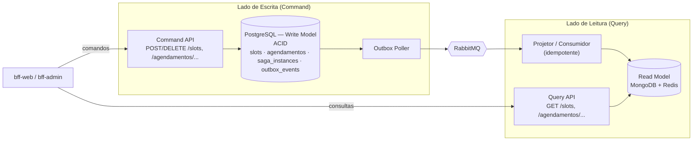

# 🔀 CQRS — Serviço de Agendamento

> O README resume: "escrita normalizada separada da leitura desnormalizada (defasagem aceitável ≤ 5 s)". Aqui estão a **justificativa**, a **modelagem** dos dois lados e o **pipeline de sincronização**.

## 1. Por que CQRS no Agendamento?

**CQRS** separa o modelo que **altera** estado (*Command / Write*) do que **consulta** (*Query / Read*).

O serviço de Agendamento tem dois perfis opostos:

| | Escrita (Command) | Leitura (Query) |
|--|-------------------|-----------------|
| Operações | Reservar, cancelar, reagendar, confirmar | Listar slots livres, ver agendamento, dashboard |
| Prioridade | **Correção** (sem overbooking) | **Latência e volume** |
| Volume | Baixo/médio | **~20–50× maior** (cada paciente consulta muito antes de agendar; gestores recarregam painéis) |
| Formato ideal | Normalizado, constraints, ACID | Desnormalizado, pronto para a tela |
| Consultas | Por chave | Filtros e agregações (UBS × especialidade × período) |
| Escala | Vertical/poucas réplicas | Horizontal (réplicas de leitura/cache) |

| Problema sem CQRS | Como o CQRS resolve |
|-------------------|---------------------|
| `JOIN`s e agregações do dashboard competem com transações de reserva no mesmo PostgreSQL | Leituras vão ao Read Model; o Write Model só trata comandos |
| Modelo normalizado é ruim para telas (muitos joins) | Documentos já "achatados" |
| Pico de leitura derruba a escrita | Escalam independentemente |
| Índices otimizados para leitura **atrasam** a escrita | Cada lado indexa para o seu uso |
| `bff-admin` precisa de agregados (ocupação, absenteísmo) | Read Model já mantém contadores |

**Quando NÃO usaríamos CQRS:** CRUD simples, baixa leitura. Aqui se justifica pelo desbalanceamento leitura/escrita e pela necessidade de agregados para o gestor.

**Custo aceito:** consistência eventual (≤ 5 s) e mais um componente (projetor). Mitigado: a **decisão de reservar nunca usa o Read Model**.

## 2. Arquitetura



## 3. Write Model — PostgreSQL (ACID)

Fonte da verdade, normalizado (3FN), com constraints que garantem as invariantes.

```sql
CREATE TABLE slots (
    id              UUID PRIMARY KEY,
    ubs_id          UUID NOT NULL,
    profissional_id UUID NOT NULL,
    especialidade   VARCHAR(64) NOT NULL,
    inicio          TIMESTAMPTZ NOT NULL,
    fim             TIMESTAMPTZ NOT NULL,
    status          VARCHAR(12) NOT NULL DEFAULT 'LIVRE'
                    CHECK (status IN ('LIVRE','RESERVADO','BLOQUEADO')),
    version         INTEGER NOT NULL DEFAULT 0,        -- lock otimista
    UNIQUE (profissional_id, inicio)
);

CREATE TABLE agendamentos (
    id            UUID PRIMARY KEY,
    paciente_id   UUID NOT NULL,                       -- referência lógica (sem FK entre serviços)
    slot_id       UUID NOT NULL REFERENCES slots(id),
    status        VARCHAR(12) NOT NULL,
    urgencia      VARCHAR(8),
    saga_id       UUID,
    criado_em     TIMESTAMPTZ NOT NULL DEFAULT now(),
    atualizado_em TIMESTAMPTZ NOT NULL DEFAULT now()
);

-- Invariante anti-overbooking garantida pelo BANCO:
CREATE UNIQUE INDEX uq_slot_agendamento_ativo
    ON agendamentos (slot_id)
    WHERE status IN ('PENDENTE','AGENDADO','CONFIRMADO');
```

Reserva = `UPDATE slots SET status='RESERVADO', version=version+1 WHERE id=:id AND status='LIVRE'` (0 linhas → `409`) + `INSERT` em `agendamentos` + `INSERT` em `outbox_events`, **numa transação** (ver [`outbox-e-consistencia.md`](../decisoes-tecnicas/outbox-e-consistencia.md)).

## 4. Read Model — MongoDB + Redis

Cada store atende a um padrão de consulta:

| Store | Conteúdo | Padrão | Por quê |
|-------|----------|--------|---------|
| **MongoDB** `agendamentos_view` | Documento do agendamento já "achatado" (+ UBS, profissional, texto de exibição) | `GET /agendamentos/{id}`, listagens, filtros | Documento único por tela, sem joins |
| **MongoDB** `ocupacao_ubs` | Contadores por UBS × especialidade × dia | Dashboard do gestor | Agregado pré-calculado (incremento atômico `$inc`) |
| **Redis** `slots:{ubs}:{espec}:{data}` (set/hash, TTL) | Slots livres | `GET /slots` (hot path) | Latência de submilissegundos |

```jsonc
// agendamentos_view
{
  "_id": "3fa85f64-...",
  "status": "AGENDADO",
  "paciente": { "id": "7c9e...", "nome": "Maria da Silva" },   // cópia de exibição
  "slot": { "id": "9b2d...", "inicio": "2026-11-05T09:30:00-03:00" },
  "ubs": { "id": "a1b2...", "nome": "UBS Centro" },
  "profissional": { "nome": "Dra. Ana Souza", "especialidade": "Clínica Geral" },
  "urgencia": "AMARELO",
  "lastEventId": "e5c1...",          // idempotência/ordenação
  "aggregateVersion": 3,             // descarta eventos fora de ordem
  "atualizadoEm": "2026-11-05T10:00:03Z"
}
```

> **Descartável e reconstruível:** o Read Model pode ser apagado e **reprojetado** a partir dos eventos/Write Model. Redis tem TTL e é cache; MongoDB é a projeção durável.

## 5. Pipeline de sincronização assíncrona

```mermaid
sequenceDiagram
    autonumber
    participant CMD as Command API
    participant PG as PostgreSQL (Write)
    participant POL as Outbox Poller
    participant MQ as RabbitMQ
    participant PRJ as Projetor
    participant MG as MongoDB (Read)
    participant RD as Redis (Read)
    participant Q as Query API

    CMD->>PG: TX: UPDATE slot + INSERT agendamento + INSERT outbox_events(SlotReservado)
    PG-->>CMD: COMMIT ✅  (t = 0)
    CMD-->>CMD: responde ao cliente (não espera o Read Model)
    POL->>PG: SELECT PENDING ... SKIP LOCKED (≤ 500 ms)
    POL->>MQ: publish SlotReservado + confirm
    POL->>PG: status = PUBLISHED
    MQ->>PRJ: entrega (fila agendamento.projetor)
    PRJ->>PRJ: dedup por eventId; ignora se aggregateVersion <= atual
    PRJ->>MG: upsert agendamentos_view; $inc ocupacao_ubs
    PRJ->>RD: remove slot do set de livres
    PRJ->>MQ: ack
    Note over PG,RD: t ≤ 5 s (SLA)
    Q->>RD: GET /slots → slot já ausente
    Q->>MG: GET /agendamentos/{id} → já visível
```

### 5.1 Eventos que alimentam o Read Model

| Evento | Efeito na projeção |
|--------|-------------------|
| `SlotReservado` | Cria/atualiza `agendamentos_view`; remove slot de `slots:*`; `ocupacao_ubs.reservados += 1` |
| `AgendamentoConfirmado` | `status = CONFIRMADO` |
| `AgendamentoCancelado` / `SlotLiberado` | `status = CANCELADO`; devolve slot ao Redis; `reservados -= 1` |
| `AtendimentoRealizado` / `FaltaRegistrada` | Atualiza status e absenteísmo |
| `EscalaCriada` | Carrega novos slots livres |

### 5.2 Orçamento de latência — SLA ≤ 5 s (p95)

| Etapa | Alvo | Máx. |
|-------|------|------|
| COMMIT → poller enxerga evento | ~250 ms | 500 ms (intervalo de polling) |
| Publicação + confirm no RabbitMQ | ~20 ms | 100 ms |
| Fila → projetor | ~50 ms | 500 ms |
| Upsert Mongo + Redis | ~50 ms | 300 ms |
| **Total esperado** | **~0,4 s** | |
| **Margem para retries/picos** | | **SLA fixado: ≤ 5 s** |

**Defasagem aceitável fixada: ≤ 5 segundos (p95); p99 ≤ 15 s; teto absoluto de alarme 30 s.**

### 5.3 Garantias e tratamento de falhas

| Cenário | Tratamento |
|---------|-----------|
| Evento duplicado (*at-least-once*) | Dedup por `eventId` (`lastEventId`/`processed_events`) |
| Evento fora de ordem | `aggregateVersion`: aplica só se maior que a versão atual; senão descarta |
| Projetor fora do ar | Mensagens acumulam na fila durável; ao voltar, drena (lag sobe, alerta) |
| Falha no processamento | Retry exponencial → DLQ + alerta |
| Read Model corrompido/perdido | **Reprojeção** completa a partir do Write Model (`aggregate_id`/Outbox histórico) |
| Outbox travado | Alerta quando `oldest_pending_age > 5 s` |

### 5.4 Monitoramento do SLA

| Métrica | Como mede | Alerta |
|---------|-----------|--------|
| `read_model_lag_seconds` | `now() - occurredAt` do último evento projetado | p95 > 5 s por 2 min |
| `outbox_oldest_pending_age_seconds` | Idade do evento PENDING mais antigo | > 5 s |
| `projector_queue_depth` | Mensagens na fila | > 500 |
| `dlq_depth` | Mensagens na DLQ | > 0 |

## 6. Consistência percebida pelo usuário

| Situação | Comportamento |
|----------|---------------|
| Paciente reserva e abre "meus agendamentos" imediatamente | `POST` retorna o recurso; o BFF pode devolver **read-your-writes** usando o corpo do comando (ou aguardar `aggregateVersion` ≥ esperado por até 2 s) |
| Slot aparece livre após ser reservado (janela ≤ 5 s) | Tentativa de reservar → `409`; UI recarrega — **seguro**, pois o Write Model decide |
| Dashboard do gestor | Tolera 5 s (e até 5 min com cache do BFF) |

## 7. Decisões e alternativas

| Decisão | Alternativa descartada | Motivo |
|---------|------------------------|--------|
| Mongo + Redis no Read Model | Réplica de leitura PostgreSQL | Réplica ainda exige joins; não oferece cache de hot path |
| Atualização via eventos (Outbox) | Triggers/consulta direta ao Write DB | Acopla e quebra a separação; sem dual write |
| Projetor idempotente com versão | Exatamente-uma-vez | Impraticável; idempotência é suficiente |
| CQRS **só** em Agendamento | CQRS em todos os serviços | Os demais não têm assimetria leitura/escrita relevante (evita complexidade desnecessária) |
| Sem *Event Sourcing* | Event Sourcing completo | Escopo/complexidade; o Write Model guarda estado atual + Outbox como histórico de eventos |

> Contexto: [`saga-agendamento.md`](saga-agendamento.md) (o resultado da SAGA gera os eventos projetados) · [`decomposicao-microsservicos.md`](decomposicao-microsservicos.md).
