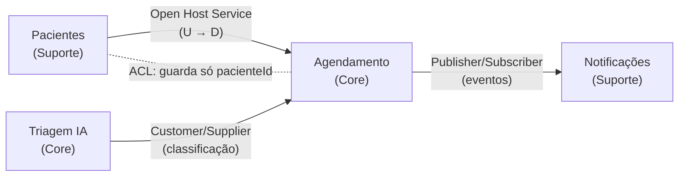
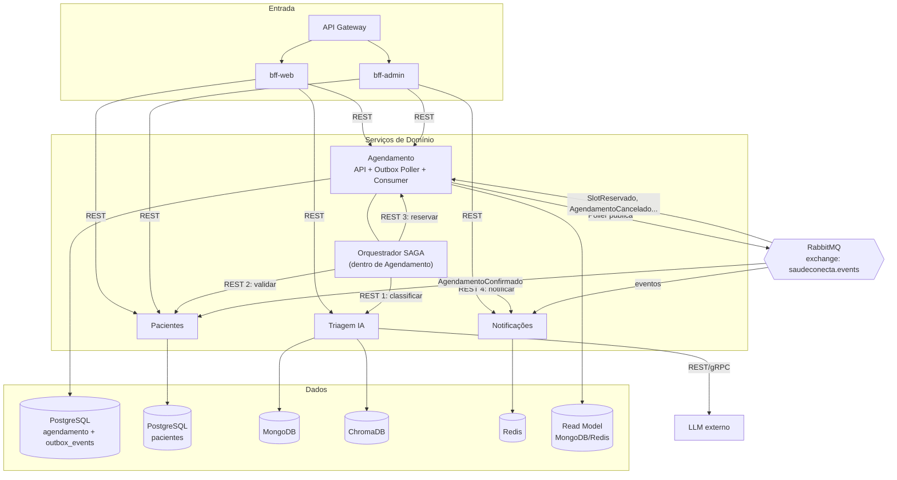

# 🧩 Decomposição em Microsserviços (DDD)

> O README lista os 4 serviços e seus bancos. Este documento explica **por que o corte é esse** (Domain-Driven Design) e detalha **como os serviços se comunicam**.

## 1. Do domínio aos Bounded Contexts

### 1.1 Linguagem ubíqua (trechos)

| Termo | Significado no SaúdeConecta |
|-------|-----------------------------|
| Paciente | Cidadão cadastrado, titular dos dados (LGPD) |
| Slot | Janela de atendimento de um profissional em uma UBS |
| Agendamento | Vínculo Paciente ↔ Slot, com ciclo de vida próprio |
| Triagem | Classificação de urgência (5 níveis) a partir de sintomas |
| Notificação | Mensagem programada (confirmação, lembrete, alerta) |

O **mesmo termo muda de sentido** conforme o contexto, sinal clássico de fronteira DDD: "Paciente" em *Pacientes* é um cadastro com credenciais; em *Agendamento* é apenas um `pacienteId` (referência); em *Triagem* é idade + sintomas; em *Notificações* é um destinatário com canais.

### 1.2 Subdomínios e Bounded Contexts

| Bounded Context | Tipo de subdomínio | Aggregate root | Invariantes protegidas | Banco | Por que esse banco |
|-----------------|-------------------|----------------|------------------------|-------|--------------------|
| **Pacientes** | Suporte (genérico) | `Paciente` | CPF único; dados sensíveis só aqui | PostgreSQL | Relacional, integridade, auditoria LGPD |
| **Agendamento** | **Core** | `Slot`, `Agendamento` | Um slot = no máximo 1 agendamento ativo; transições de estado válidas | PostgreSQL (write) | **ACID** contra *overbooking* |
| **Triagem IA** | **Core** (diferencial) | `Triagem` | Resultado sempre acompanha justificativa e fontes | MongoDB + ChromaDB | Documentos flexíveis + busca vetorial (RAG) |
| **Notificações** | Suporte | `Notificacao` | Entrega no máximo 1× por (agendamento, tipo) | Redis | Filas/agendamento por TTL, baixa latência |

### 1.3 Critérios usados no corte

| Critério | Aplicação |
|----------|-----------|
| **Coesão de linguagem** | Cada contexto tem vocabulário próprio e consistente |
| **Fronteira transacional** | A invariante crítica (sem overbooking) cabe em **um** banco — Agendamento |
| **Taxa de mudança** | Triagem muda por modelo/protocolo; Notificações por canais; Pacientes raramente |
| **Perfil de carga** | Agendamento: picos de manhã; Triagem: CPU/latência de LLM; Notificações: rajadas assíncronas |
| **Tecnologia ideal** | Cada serviço escolhe o armazenamento adequado (*polyglot persistence*) |
| **Autonomia de equipe** | Um contexto = um time pode evoluir e implantar sozinho |
| **Segurança/LGPD** | Dados pessoais confinados em Pacientes; os demais guardam só IDs |

### 1.4 Alternativas descartadas

| Alternativa | Motivo da rejeição |
|-------------|--------------------|
| Monólito modular | Não demonstra/permite escala e stack independentes (requisito da disciplina) e acopla IA ao agendamento |
| Serviço "Slot" separado de "Agendamento" | Quebraria a invariante anti-overbooking em duas transações → forçaria SAGA onde um ACID resolve |
| Triagem dentro de Agendamento | Ciclos de mudança e perfil de carga (LLM) muito diferentes |
| Serviço "Usuário" + "Paciente" | Granularidade excessiva (*nano-services*) para o escopo |

### 1.5 Context Map

- **Open Host Service** (Pacientes): API estável e publicada (OpenAPI).
- **Customer/Supplier** (Triagem → Agendamento): Agendamento depende da urgência para priorizar; contrato negociado.
- **Published Language** (eventos): Notificações consome eventos de Agendamento sem conhecer seu modelo interno.
- **Anti-Corruption Layer**: cada serviço traduz o que recebe para seu modelo; nenhum compartilha tabelas.

## 2. Componentes e comunicação

O README mostra a visão macro (Cliente → Gateway → BFF → Serviços → Bancos). O diagrama abaixo foca em **quem fala com quem e por qual canal**.

### 2.1 Comunicação síncrona (HTTP/REST)

| De → Para | Finalidade | Por que síncrona | Timeout / resiliência |
|-----------|-----------|------------------|-----------------------|
| Gateway → BFFs | Entrada de requisições | Resposta imediata ao usuário | 10 s |
| BFF → Pacientes/Agendamento/Triagem/Notificações | Composição de telas | O usuário espera o dado | 2–3 s, retry (GET), *circuit breaker* |
| Orquestrador → serviços (SAGA) | Comandos com resposta de sucesso/falha | O próximo passo depende do resultado | 3 s (Triagem: 10 s), retry idempotente |

**Regra:** REST para *perguntas* e *comandos que precisam de resposta imediata*.

### 2.2 Comunicação assíncrona (RabbitMQ)

| Evento (v1) | Produtor | Consumidores | Efeito |
|-------------|----------|--------------|--------|
| `AgendamentoCriado` | Agendamento | Notificações | Agenda confirmação/lembretes |
| `SlotReservado` | Agendamento | Agendamento (projetor) | Atualiza **Read Model** (CQRS) |
| `AgendamentoCancelado` | Agendamento | Notificações, projetor | Cancela lembretes, libera slot na leitura |
| `AgendamentoConfirmado` | Agendamento | Pacientes | Atualiza histórico |
| `AtendimentoRealizado` / `FaltaRegistrada` | Agendamento | Pacientes, projetor | Histórico e métricas de absenteísmo |
| `PacienteAtualizado` | Pacientes | Agendamento | Atualiza cópia local de dados de exibição |

| Característica | Decisão |
|----------------|---------|
| Topologia | 1 *topic exchange* `saudeconecta.events`; routing key `agendamento.slot.reservado` |
| Filas | Uma por consumidor (`notificacoes.agendamento`, `agendamento.projetor`); duráveis |
| Garantia | *At-least-once* → consumidores **idempotentes** (tabela de `event_id` processados) |
| Falhas | DLQ + retry exponencial |
| Envelope | `eventId`, `eventType`, `version`, `occurredAt`, `correlationId`, `payload` |
| Publicação | **Transactional Outbox** — ver [`outbox-e-consistencia.md`](../decisoes-tecnicas/outbox-e-consistencia.md) |

**Regra:** eventos para *fatos já ocorridos* que outros serviços reagem **sem que o produtor espere**.

### 2.3 Síncrono × Assíncrono — resumo da decisão

| Pergunta | Se SIM → |
|----------|---------|
| O chamador precisa do resultado agora para continuar? | REST |
| É a notificação de um fato que vários podem ignorar/atrasar? | Evento |
| Precisa atualizar visão derivada (cache/read model)? | Evento |
| Falha do destino deve derrubar o chamador? | Não → Evento |

## 3. Acoplamento e autonomia

- **Nenhum serviço lê o banco do outro** (Database per Service).
- Se **Notificações** cair, agendar continua funcionando: o evento fica na fila (o passo 4 da SAGA é a única dependência síncrona, tratada pela compensação ou *retry*).
- Dados replicados (ex.: nome do paciente para exibição) são **cópias eventualmente consistentes**, nunca fonte de verdade.
- O Orquestrador mora no serviço de **Agendamento** (dono do processo de negócio), evitando um 5º serviço.

> Detalhes da SAGA em [`saga-agendamento.md`](saga-agendamento.md) e do CQRS em [`cqrs-agendamento.md`](cqrs-agendamento.md).
