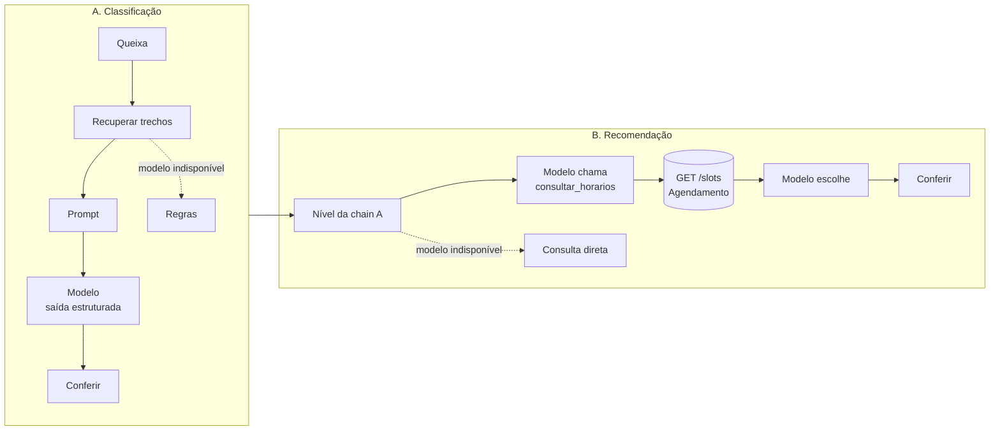

# LLM da Triagem

O modelo classifica a urgência da queixa a partir dos trechos recuperados pelo [RAG](rag-triagem.md) e ajuda a escolher um horário real. Não é um chatbot: são duas operações com entrada e saída definidas. O modelo **sugere**; não diagnostica nem prescreve.

## Provedor

O padrão é o **DeepSeek** (`deepseek-flash`, sem raciocínio); o **Gemini** (`gemini-3.5-flash-lite`) continua como alternativa. Os dois passam pelas mesmas chains, pela mesma tool e pela mesma proteção; muda só o cliente (`app/llm/modelo.py`).

| Decisão | Motivo |
|---------|--------|
| DeepSeek como padrão | Nas 24 perguntas com gabarito acertou mais e respondeu dentro de 3,5 s em todas; o Gemini gratuito oscilou (2 de 5 chamadas falharam em 24/11). Comparação em [`llm-latencia-custo.md`](../llm-latencia-custo.md) e [`rag-avaliacao.md`](../rag-avaliacao.md) |
| Sem raciocínio | Medimos os esforços low, high e max: 2 a 3 vezes mais lentos, sem acertar mais |
| Saída estruturada por chamada de função | O DeepSeek aceita chamada de função com a ferramenta escolhida só sem raciocínio, e é o mesmo mecanismo da tool |
| Gemini mantido | Troca por variável, sem mexer no código; serve de plano B se um dos provedores cair |

## Chains (LangChain)

- **A. Classificação:** `POST /triagens`, passo 1 da SAGA.
- **B. Recomendação:** `POST /triagens/recomendacoes`, antes da SAGA.



| Decisão | Motivo |
|---------|--------|
| Duas chains fixas, sem agente | A ordem é sempre a mesma; decisão dinâmica só traria tempo e custo imprevisíveis |
| Tool só na recomendação, fora da SAGA | Na SAGA, o Agendamento chama a Triagem; a volta criaria dependência circular no meio da transação |
| UBS e prazo máximo fixados no servidor | O modelo não escolhe outra unidade nem afrouxa a urgência |
| Só horários devolvidos pela tool são aceitos | O modelo não inventa horário |
| Saída estruturada e validada | Resposta fora do formato conta como falha |

## Segurança e privacidade

- **A regra só eleva:** sinais de alarme reconhecidos por regra aumentam a urgência do modelo, nunca diminuem. Vale também para resposta vinda do cache.
- **Dúvida:** com confiança abaixo de 0,5, ou sem nenhum trecho de apoio na base, o nível passa a no mínimo AMARELO.
- **O que sai para o provedor:** queixa e faixa etária. Nome, CPF, id e idade exata não são enviados; CPF, telefone, e-mail e "meu nome é..." escritos na queixa são removidos. A remoção é por padrão de texto: um nome solto no meio da frase pode passar.
- **Instruções na queixa:** o texto vai entre marcas, como dado; mesmo que o modelo obedeça, as regras e a validação continuam valendo.
- **Remédio e dose:** texto com cara de prescrição é trocado por uma orientação padrão.

## Dependência remota falível

| Mecanismo | Parâmetros |
|-----------|------------|
| Timeout | 3,5 s por tentativa; teto de 8 s para a classificação inteira e 12 s para a recomendação |
| Nova tentativa | 1, após cerca de 0,2 s com variação aleatória; só para tempo esgotado, conexão, 5xx e resposta inválida. 429 e demais 4xx não repetem |
| Circuit breaker | Abre com 3 falhas seguidas, fica 30 s aberto e testa com uma chamada. Por réplica |
| Cache por chave | Hash de queixa normalizada, faixa etária, modelo, versão do prompt e da base; 24 h no MongoDB. Não guarda a queixa |
| Fallback | Regras com os mesmos trechos (`origem: REGRAS`); na recomendação, consulta direta à agenda |

Detalhes que os testes cobrem:
- Os SDKs repetiriam por dentro (o do Gemini, até 6 vezes); está desligado nos dois, e o teste conta os pedidos que chegam ao servidor.
- O limite de cada tentativa inclui a resolução de nome, que o timeout do cliente HTTP não cobre.
- O SDK do Gemini repassa o timeout como prazo do servidor; ele fica fixo em 10 s, para o provedor não recusar 3,5 s.
- Sem trechos recuperados, a resposta não vai para o cache.

`GET /triagens/saude-llm` mostra circuito, latência, tokens, cache, fallbacks e falhas por motivo da réplica que respondeu.

## Configuração

| Variável | Uso |
|----------|-----|
| `DEEPSEEK_API_KEY` | Chave do DeepSeek (padrão do projeto) |
| `GEMINI_API_KEY` | Chave do Google AI Studio (alternativa). Sem nenhuma das duas, a triagem trabalha por regras |
| `LLM_PROVEDOR` | `deepseek` ou `gemini`. Vazio: o DeepSeek, se houver a chave dele |
| `LLM_MODELO` | Padrão `deepseek-flash` ou `gemini-3.5-flash-lite` |
| `LLM_URL` | Endereço alternativo da API (usado nos testes) |

As chaves ficam no `.env` local, nunca no repositório. Os servidores do DeepSeek ficam na China, e na camada gratuita do Gemini o provedor pode usar o conteúdo enviado para melhorar os próprios produtos. Com dado real de paciente, os dois exigiriam base legal para transferência internacional (LGPD): **usar só dados fictícios**.

```bash
scripts/verificar_llm.sh   # prova tudo acima na stack real, sem chave (~3 min)
```

Os testes rodam com os clientes reais do DeepSeek e do Gemini contra um [servidor falso](../../services/triagem/tests/gemini_falso.py) que fala as duas APIs; o script usa o do Gemini. Provam a integração e as falhas, **não a qualidade do modelo**, medida em [`rag-avaliacao.md`](../rag-avaliacao.md).

## Limitações
- O provedor externo pode ficar lento ou fora (o Gemini gratuito, com 15 chamadas por minuto, oscilou bastante). Medidas em [`llm-latencia-custo.md`](../llm-latencia-custo.md).
- Circuito e indicadores são por réplica e zeram ao reiniciar.
- A lista de sinais de alarme é do grupo, sem validação clínica, e não reconhece toda forma de descrever um sintoma: sozinhas, as regras são bem mais fracas que o modelo ([avaliação](../rag-avaliacao.md)).
