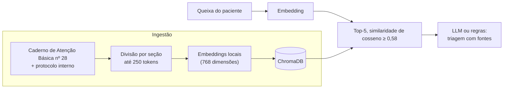

# RAG da Triagem

Recuperação de trechos de protocolos para fundamentar a triagem. Os trechos entram no prompt do modelo e viram **fontes citadas** (documento, seção e página); sem o modelo, a triagem por regras cita os mesmos trechos. A geração está em [llm-triagem.md](llm-triagem.md).



## Base de conhecimento

| Documento | Conteúdo | Trechos |
|-----------|----------|---------|
| Caderno de Atenção Básica nº 28, vol. I e II (Ministério da Saúde) | Acolhimento e 28 queixas comuns, com sinais de alerta e condutas | 887 |
| Protocolo interno SaúdeConecta | Escala de 5 níveis, prazos, especialidade e sinais nas palavras do paciente | 23 |

O Caderno não traz uma escala de cinco cores; ela e os prazos são **decisão do grupo, sem validação clínica**. Textos, licença e extração: [`services/triagem/base`](../../services/triagem/base/README.md).

## Decisões

| Decisão | Motivo |
|---------|--------|
| Embeddings locais, dentro da imagem | Sem custo por chamada, sem enviar a queixa do paciente para fora, e a busca funciona com a internet fora |
| `gte-multilingual-base` (ONNX int8) | Melhor resultado na comparação abaixo |
| Trechos de até 250 tokens, sobreposição de 40 | Acerto igual ou melhor que trechos maiores, com um terço do texto enviado ao LLM |
| Corte em 0,58 | Das 32 queixas, 30 têm trecho certo acima dele; de 15 frases fora do assunto, 1 passa (texto sem sentido) |
| Uma coleção por versão da base | Conteúdo, modelo ou divisão diferentes geram outra coleção; a antiga só sai quando a nova está completa |
| Cliente REST próprio, com prazo de 1,5 s | O cliente oficial usa `timeout=None`: um ChromaDB travado seguraria a SAGA |
| Protocolo interno na mesma coleção | Liga o vocabulário do paciente ("se debater") ao do Caderno ("crise epiléptica") |

**Comparação de modelos:** 32 queixas em linguagem de paciente, só com o Caderno; conta como acerto trazer o capítulo certo.

| Modelo | Limite de entrada | 1º lugar | Entre os 5 | Trechos |
|--------|-------------------|----------|------------|---------|
| paraphrase-multilingual-MiniLM-L12 | 128 tokens | 15 | 22 | 250 |
| multilingual-e5-small (int8) | 512 | 15 | 24 | 250 |
| multilingual-e5-base (int8) | 512 | 17 | 23 | 250 |
| **gte-multilingual-base (int8)** | 8192 | **26** | **29** | 250 |
| gte-multilingual-base (int8) | 8192 | 25 | 27 | 400 |
| gte-multilingual-base (int8) | 8192 | 27 | 28 | 800 |

Estas 32 queixas serviram para **escolher** modelo e corte, portanto não medem a qualidade final. A avaliação usa outras perguntas.

## Falhas

| Situação | Comportamento |
|----------|---------------|
| ChromaDB fora, travado ou com nome que não resolve | Triagem responde sem fontes em até 1,5 s e fica 5 s sem tentar de novo; a SAGA conclui |
| Base ainda não carregada, ou carga pela metade | Não é usada: melhor sem fonte que com fonte errada |
| Volume do ChromaDB perdido | Rodar a ingestão de novo; a Triagem encontra a coleção nova sem reiniciar |
| Ingestão repetida ou interrompida | Não duplica: o id do trecho vem do conteúdo |

```bash
scripts/verificar_rag.sh                                                         # prova tudo acima, ~3 min
docker compose exec triagem python -m app.rag.busca "dor no peito"               # trechos e páginas
docker compose run --rm triagem-ingestao                                         # ingestão manual
```

## Limitações
- O ChromaDB 1.x não tem autenticação. A proteção é a rede: só a Triagem e a ingestão o alcançam. O conteúdo é público.
- O ChromaDB 1.5.9 não fecha os arquivos de coleções apagadas (4 por coleção). Só importa depois de centenas de trocas de versão da base sem reiniciá-lo.
- Quadros de várias colunas do Caderno saem em linha corrida, e fluxogramas, sem as setas.
- Queixas fora do vocabulário podem trazer o capítulo errado ("bolhinhas no lábio" traz odontologia em vez de herpes).
- Cada réplica da Triagem ocupa cerca de 0,8 GB por causa do modelo.
- O `onnxruntime` envia telemetria por padrão; está desligada na imagem (`ORT_DISABLE_TELEMETRY=1`).
