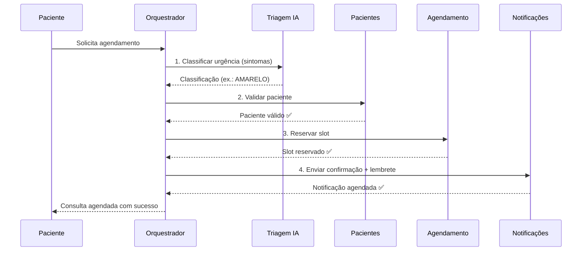
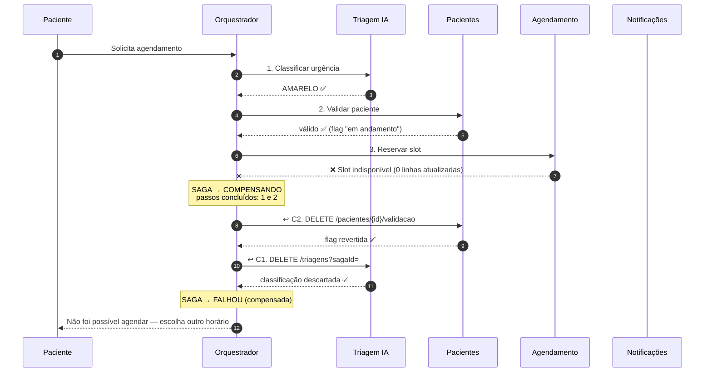
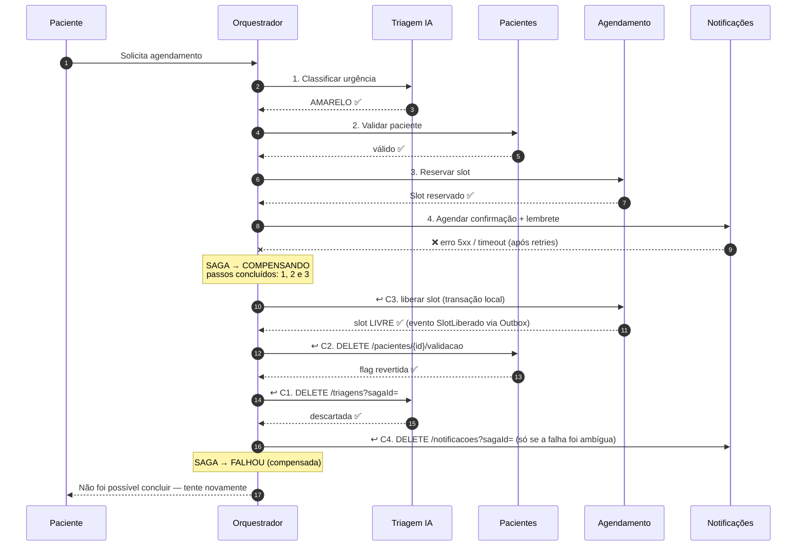
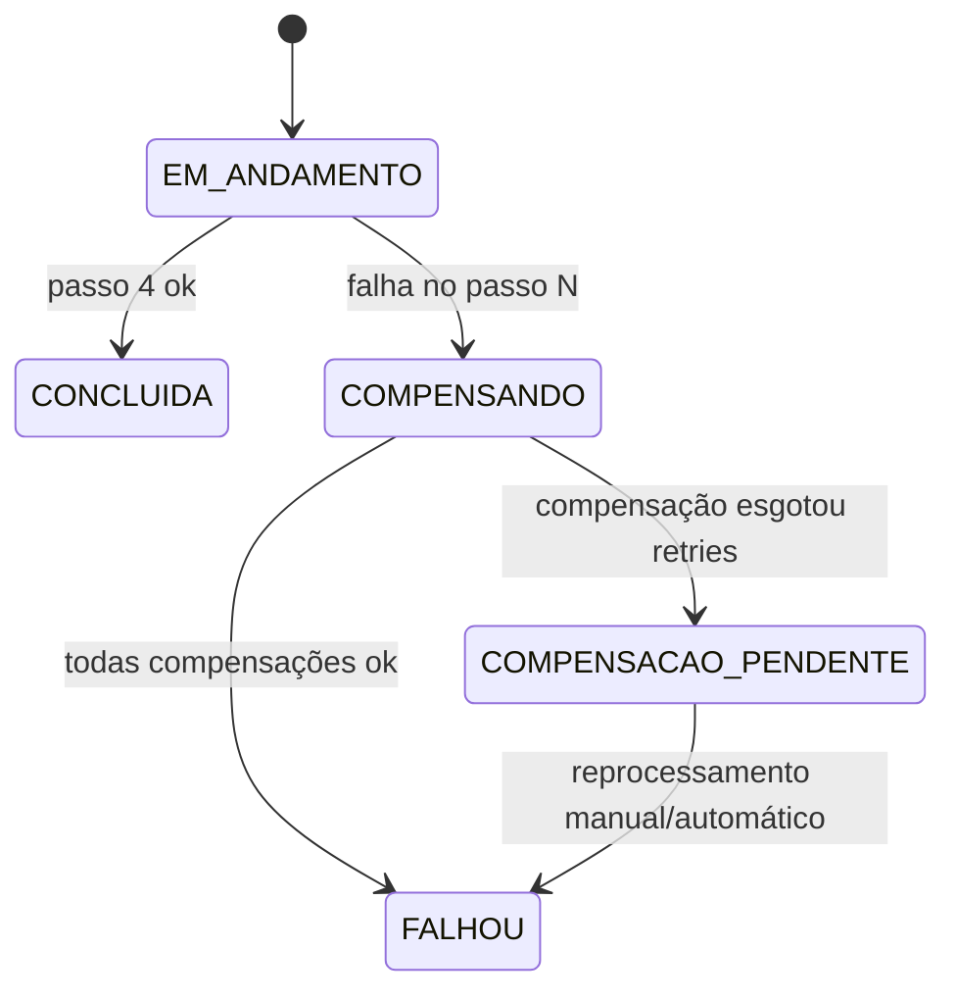

# 🔄 SAGA Orquestrada — Agendamento

> Caminho feliz, compensações, **justificativa** Orquestrada × Coreografada e **diagramas de falha** com compensações em cascata.

## 1. Por que SAGA?

Agendar envolve 4 serviços, cada um com seu banco. Sem transação distribuída (ver [`outbox-e-consistencia.md`](../decisoes-tecnicas/outbox-e-consistencia.md)), uma SAGA é uma sequência de transações locais; se uma falha, **transações compensatórias** desfazem as anteriores.

## 2. Orquestrada × Coreografada

| Critério | Coreografada (eventos, sem chefe) | **Orquestrada** (orquestrador central) |
|----------|-----------------------------------|----------------------------------------|
| Controle do fluxo | Distribuído; cada serviço reage a eventos | Centralizado em um orquestrador |
| Visibilidade do processo | Difícil: fluxo "escondido" em N serviços | **Um lugar** com o estado da SAGA |
| Acoplamento | Serviços conhecem eventos uns dos outros (ciclos) | Serviços só conhecem seu comando; o orquestrador conhece o fluxo |
| Ordem estrita dos passos | Emergente, frágil | **Explícita** (1→2→3→4) |
| Compensação | Cada serviço decide quando desfazer; risco de esquecer/duplicar | **Cascata determinística** em ordem inversa |
| Adicionar/alterar passo | Mexe em vários serviços | Muda o orquestrador |
| Depuração / auditoria | Rastrear eventos em várias filas | Tabela `saga_instances` + logs por `sagaId` |
| Timeout / SLA do fluxo | Difícil implementar | Natural (timeout por passo) |
| Ponto único de falha | Não | Mitiga-se: estado persistido, réplicas, retomada |
| Indicada para | Poucos passos (2–3), fluxos simples | **4+ passos, ordem e compensação críticas** |

**Decisão: Orquestrada**, porque:

1. O fluxo tem **4 passos com dependência de ordem** (a urgência define o slot; o slot define a notificação).
2. Compensação precisa ser **completa e ordenada** (inversa); em coreografia o risco de *estado órfão* (slot preso) é alto.
3. A banca e os gestores precisam **auditar** "em qual passo falhou?" — requisito de transparência no SUS.
4. O escopo é pequeno: o orquestrador **vive no serviço de Agendamento** (dono do processo), sem criar um 5º serviço.
5. Reduz o *event spaghetti*: RabbitMQ fica para *propagação de fatos* (Outbox/CQRS), não para controlar fluxo.

**Riscos e mitigações**

| Risco | Mitigação |
|-------|-----------|
| Orquestrador como SPOF | Estado persistido em `saga_instances`; qualquer réplica retoma SAGAs `EM_ANDAMENTO` |
| Orquestrador "inteligente demais" | Só sequência e compensação; regra de negócio fica nos serviços |
| Compensação falhar | Compensações **idempotentes** + retry com backoff; esgotado → `COMPENSACAO_PENDENTE` + alerta |
| Passo repetido | `Idempotency-Key = sagaId + passo` |

## 3. Caminho feliz



Ao concluir, o orquestrador grava `AGENDADO` e o evento `AgendamentoCriado` (Outbox) na mesma transação. Esse evento fecha os estados temporários: **Pacientes** limpa a flag "em andamento", **Triagem** torna a classificação definitiva e **Notificações** libera o envio. Até lá nada é enviado: senão uma SAGA que falhasse depois do passo 4 deixaria o paciente com a confirmação de uma consulta inexistente.

## 4. Tabela de compensações

| Passo | Ação | Compensação |
|-------|------|-------------|
| 1. Triagem | Classificar urgência | Descartar classificação temporária |
| 2. Pacientes | Validar e marcar "agendamento em andamento" | Reverter flag |
| 3. Agendamento | Reservar slot (transação local) | Liberar slot reservado (transação local) |
| 4. Notificações | Agendar confirmação e lembretes | Cancelar todas as notificações da SAGA |

Endpoints (ver contratos OpenAPI): `DELETE /triagens?sagaId=` · `DELETE /pacientes/{id}/validacao` (com `X-Saga-Id`) · `DELETE /notificacoes?sagaId=`. O passo 3 não passa pela rede: o orquestrador vive no próprio serviço de Agendamento.

**Por que tudo é identificado por `sagaId`:**

- **Segurança:** uma compensação nunca desfaz o trabalho de **outra** SAGA (ex.: liberar o horário que outro paciente acabou de reservar, ou limpar a flag de outro agendamento em curso).
- **Timeout:** se a resposta se perdeu, o orquestrador não conhece o id criado no serviço remoto, mas sempre conhece o `sagaId`.
- **Pedido atrasado:** um pedido perdido num timeout pode ser entregue **depois** da compensação. Cada participante registra as SAGAs encerradas e recusa esse pedido com `409`; sem isso, a flag do paciente ficaria presa para sempre.

## 5. Cenário de falha

**Regra:** só se compensam passos **já concluídos**, em **ordem inversa**. O passo que falhou não precisa de compensação (sua transação local deu rollback), mas pode precisar de limpeza defensiva (idempotente).

### 5.1 Falha no passo 3 — Reserva de Slot (ex.: slot tomado por outro paciente)



Passo 4 **nunca chegou a executar** → sem compensação.

### 5.2 Falha no passo 4 — Notificação



> **Quando o próprio passo que falhou precisa de compensação.** O orquestrador distingue dois casos:
> - **a conexão nunca abriu** (serviço desligado): o participante certamente não executou; não há o que desfazer;
> - **falha ambígua** (timeout, queda no meio, 5xx): pode ter executado. A compensação dele entra **por último** na lista, porque ele provavelmente ainda está fora e esperar prenderia o horário do paciente.
>
> Uma compensação que falha **não impede as outras**: a SAGA fica em `COMPENSACAO_PENDENTE` e a pendente é repetida, com espera crescente, até dar certo.

### 5.3 Urgência VERMELHO

Se a triagem resultar em **VERMELHO**, a SAGA **não agenda**: emergência não espera consulta. O orquestrador compensa o passo 1 e devolve a orientação de procurar atendimento imediato (SAMU 192).

### 5.4 Estados da SAGA



### 5.5 Decisões de projeto para o fluxo de falha

| Tema | Decisão |
|------|---------|
| Persistência | `saga_instances` (estado, passo atual, lista a compensar, *lease*) e `saga_log` (histórico) no PostgreSQL de Agendamento. O passo 3 e a conclusão gravam estado, dado e evento na **mesma transação** |
| Dado de saúde | Os sintomas ficam em `saga_instances` só até o passo 1 terminar; depois são apagados (Agendamento não guarda dado clínico) |
| Timeout por passo | Triagem: 10 s, **sem retry por timeout** (ela já resolve timeout, retry e fallback do LLM em até 8 s; repetir aqui multiplicaria a espera). Demais: 3 s, 2 retries |
| Falha de notificação | Tratada como falha da SAGA (conforme requisito). Alternativa avaliada: tornar passo 4 *"best effort"* via evento (ver trade-off abaixo) |
| Idempotência | Toda ação remota leva `Idempotency-Key = sagaId:passo`; compensações são por `sagaId` e `DELETE` repetido devolve `204` |
| Flag "em andamento" | Guarda o `sagaId` dono. Limpa por C2 (falha) ou por `AgendamentoCriado` (sucesso) |
| Sem LLM | Triagem responde `201` por regras (`origem: REGRAS`); a indisponibilidade do modelo não derruba o agendamento |
| Compensação de passo não executado | Tolerada (404/204 = sucesso) |
| Resposta ao usuário | `POST /agendamentos` → `202` + `Location`; o id é gerado no POST e `AgendamentoSolicitado` projeta `PENDENTE`. Status final via `GET /agendamentos/{id}` (`AGENDADO` ou `CANCELADO`, com `motivo`). A leitura pode levar até 5 s para enxergar o novo id; até lá o BFF usa o corpo do `202` |
| Auditoria | `GET /sagas/{id}`: estado, passos, compensações e horários |
| Rastreio | `sagaId` + `X-Correlation-Id` em logs e eventos |
| Retomada | Cada SAGA tem um *lease* (`locked_until`, 15 s, renovado a cada passo). Toda gravação confere o dono do *lease* (*fencing*): uma réplica que travou e voltou não consegue prosseguir. Qualquer réplica assume, com `FOR UPDATE SKIP LOCKED`, as que expiraram em `EM_ANDAMENTO`, `COMPENSANDO` ou `COMPENSACAO_PENDENTE` |

**Trade-off do passo 4:** notificação é periférica; falhar a SAGA devolve o slot por uma falha de SMS. A especificação do projeto trata o passo como compensável (rigor máximo); em evolução futura pode virar evento assíncrono com *retry* (a reserva já estaria garantida).

> O estado final alimenta o Read Model — ver [`cqrs-agendamento.md`](cqrs-agendamento.md).

## 6. Como comprovar

```bash
scripts/testar.sh agendamento    # falha em cada passo, ambígua ou não; queda de réplica; concorrência
scripts/verificar_saga.sh        # stack real: Notificações desligado, Triagem morta, kill -9 no orquestrador
```

Com a stack no ar, `GET /api/v1/sagas/{id}` mostra cada passo e cada compensação com horário e duração.
