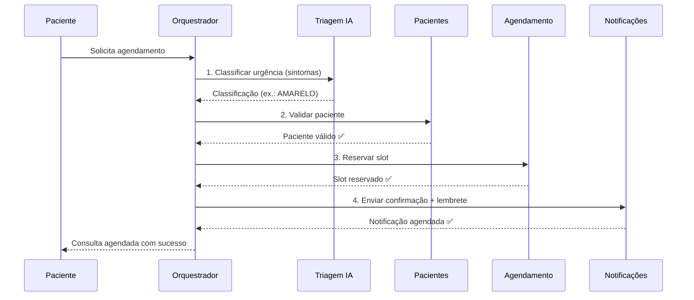
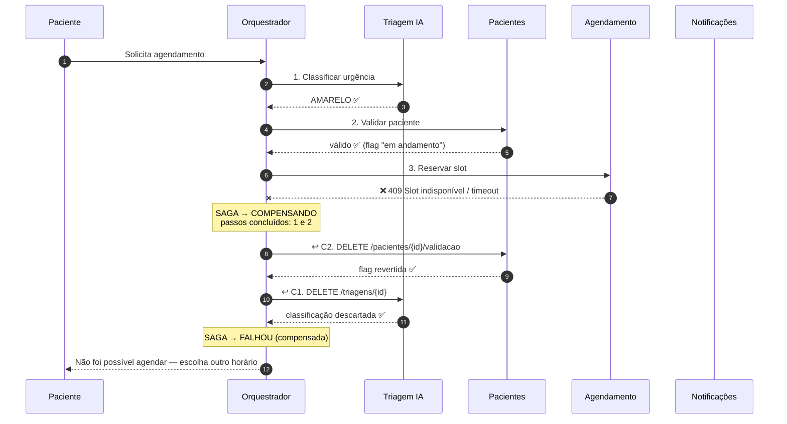
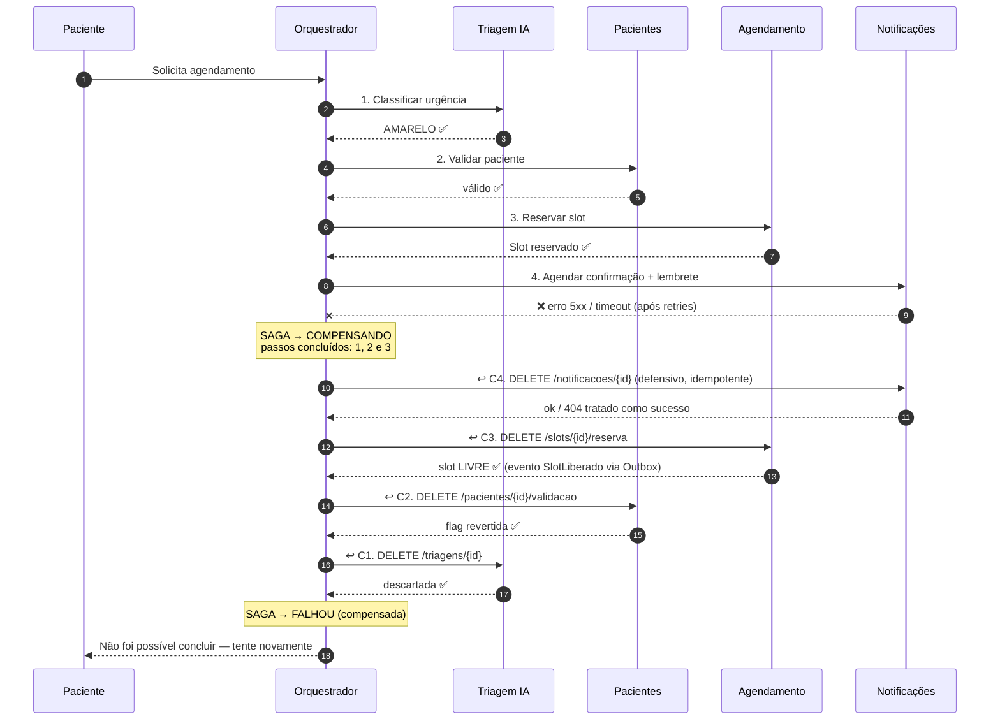
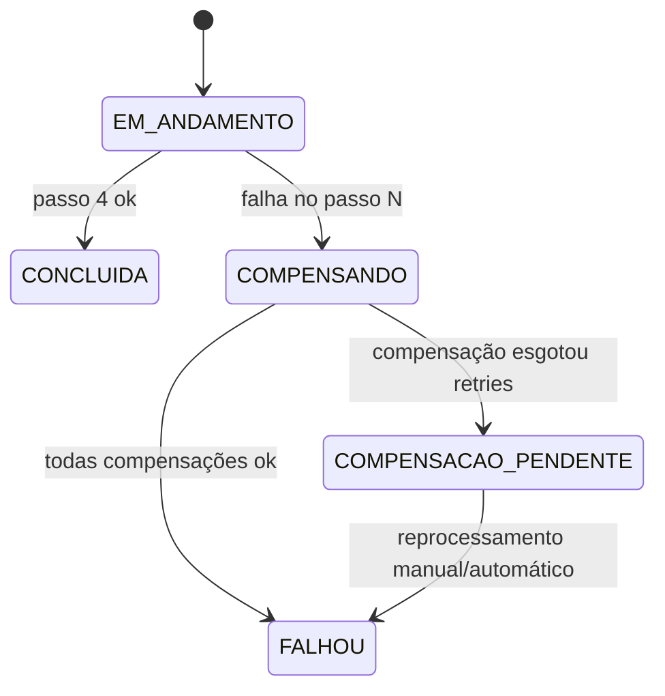

# 🔄 SAGA Orquestrada — Agendamento

> O README já traz o **caminho feliz** e a **tabela de compensações** (mantidos, abaixo, sem alteração de conteúdo). Este documento adiciona: a **justificativa** Orquestrada × Coreografada e o **diagrama do cenário de falha** com compensações em cascata.

## 1. Por que SAGA?

Agendar envolve 4 serviços, cada um com seu banco. Sem transação distribuída (ver [`outbox-e-consistencia.md`](../decisoes-tecnicas/outbox-e-consistencia.md)), uma SAGA é uma sequência de transações locais; se uma falha, **transações compensatórias** desfazem as anteriores.

## 2. Orquestrada × Coreografada

| Critério | Coreografada (eventos, sem chefe) | **Orquestrada** (orquestrador central) |
|----------|-----------------------------------|----------------------------------------|
| Controle do fluxo | Distribuído; cada serviço reage a eventos | Centralizado em um orquestrador |
| Visibilidade do processo | Difícil: fluxo "escondido" em N serviços | **Um lugar** com o estado da SAGA |
| Acoplamento | Serviços conhecem eventos uns dos outros (ciclos) | Serviços só conhecem seu comando; o orquestrador conhece o fluxo |
| Ordem estrita dos passos | Emergente, frágil | **Explícita** (1→2→3→4) |
| Compensação | Cada serviço decide quando desfazer; risco de esquecer/duplicar | **Cascata determinística** em ordem inversa |
| Adicionar/alterar passo | Mexe em vários serviços | Muda o orquestrador |
| Depuração / auditoria | Rastrear eventos em várias filas | Tabela `saga_instances` + logs por `sagaId` |
| Timeout / SLA do fluxo | Difícil implementar | Natural (timeout por passo) |
| Ponto único de falha | Não | Mitiga-se: estado persistido, réplicas, retomada |
| Indicada para | Poucos passos (2–3), fluxos simples | **4+ passos, ordem e compensação críticas** |

**Decisão: Orquestrada**, porque:

1. O fluxo tem **4 passos com dependência de ordem** (a urgência define o slot; o slot define a notificação).
2. Compensação precisa ser **completa e ordenada** (inversa); em coreografia o risco de *estado órfão* (slot preso) é alto.
3. A banca e os gestores precisam **auditar** "em qual passo falhou?" — requisito de transparência no SUS.
4. O escopo é pequeno: o orquestrador **vive no serviço de Agendamento** (dono do processo), sem criar um 5º serviço.
5. Reduz o *event spaghetti*: RabbitMQ fica para *propagação de fatos* (Outbox/CQRS), não para controlar fluxo.

**Riscos e mitigações**

| Risco | Mitigação |
|-------|-----------|
| Orquestrador como SPOF | Estado persistido em `saga_instances`; qualquer réplica retoma SAGAs `EM_ANDAMENTO` |
| Orquestrador "inteligente demais" | Só sequência e compensação; regra de negócio fica nos serviços |
| Compensação falhar | Compensações **idempotentes** + retry com backoff; esgotado → `COMPENSACAO_PENDENTE` + alerta |
| Passo repetido | `Idempotency-Key = sagaId + passo` |

## 3. Caminho feliz *(mantido do README)*

## 4. Tabela de compensações *(mantida do README)*

| Passo | Ação | Compensação |
|-------|------|-------------|
| 1. Triagem | Classificar urgência | Descartar classificação temporária |
| 2. Pacientes | Validar e marcar "agendamento em andamento" | Reverter flag |
| 3. Agendamento | Reservar slot | Liberar slot reservado |
| 4. Notificações | Agendar confirmação | Cancelar notificação agendada |

Endpoints (ver contratos OpenAPI): `DELETE /triagens/{id}` · `DELETE /pacientes/{id}/validacao` · `DELETE /slots/{id}/reserva` · `DELETE /notificacoes/{id}`.

## 5. Cenário de falha

**Regra:** só se compensam passos **já concluídos**, em **ordem inversa**. O passo que falhou não precisa de compensação (sua transação local deu rollback), mas pode precisar de limpeza defensiva (idempotente).

### 5.1 Falha no passo 3 — Reserva de Slot (ex.: slot tomado por outro paciente)

Passo 4 **nunca chegou a executar** → sem compensação.

### 5.2 Falha no passo 4 — Notificação

### 5.3 Estados da SAGA

### 5.4 Decisões de projeto para o fluxo de falha

| Tema | Decisão |
|------|---------|
| Persistência | `saga_instances(saga_id, estado, passo_atual, passos_concluidos[], payload, timeout_em)` no PostgreSQL de Agendamento, atualizada na mesma transação das mudanças |
| Timeout por passo | Triagem 10 s; demais 3 s; 2 retries antes de declarar falha |
| Falha de notificação | Tratada como falha da SAGA (conforme requisito). Alternativa avaliada: tornar passo 4 *"best effort"* via evento (ver trade-off abaixo) |
| Idempotência | Toda ação e compensação aceita `Idempotency-Key`; `DELETE` repetido devolve `204` |
| Compensação de passo não executado | Tolerada (404/204 = sucesso) |
| Resposta ao usuário | `POST /agendamentos` → `202` + `Location`; status final via `GET /agendamentos/{id}` (`PENDENTE` → `AGENDADO` ou `CANCELADO`) |
| Rastreio | `sagaId` + `X-Correlation-Id` em logs e eventos |
| Retomada | No *startup*, o orquestrador retoma SAGAs `EM_ANDAMENTO`/`COMPENSANDO` expiradas |

**Trade-off do passo 4:** notificação é periférica; falhar a SAGA devolve o slot por uma falha de SMS. A especificação do projeto trata o passo como compensável (rigor máximo); em evolução futura pode virar evento assíncrono com *retry* (a reserva já estaria garantida).

> O estado final alimenta o Read Model — ver [`cqrs-agendamento.md`](cqrs-agendamento.md).
