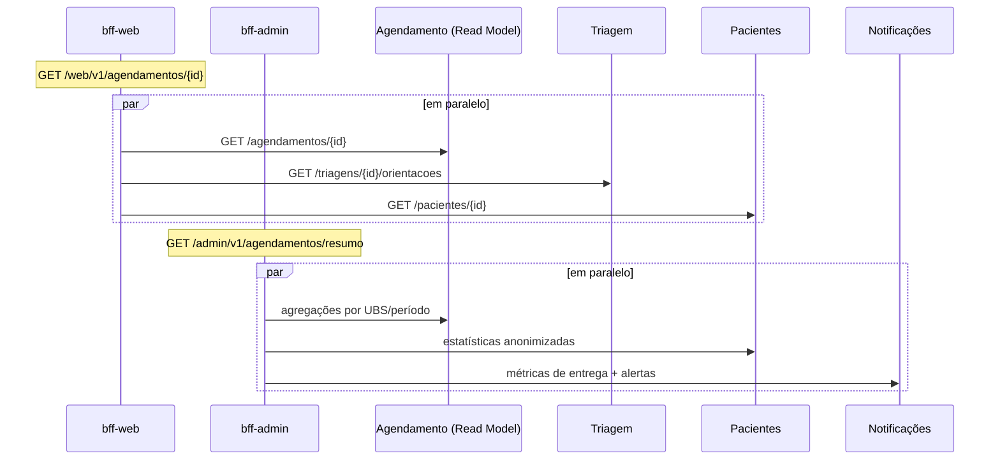

# 📱📊 BFF — Por que dois? Comparativo de Payloads

> O README define: `bff-web` devolve dados simples, pessoais e acionáveis; `bff-admin` devolve dados agregados e analíticos. Aqui está a **justificativa técnica** e o **payload diff** para a mesma entidade.

## 1. Justificativa técnica

Um BFF (*Backend for Frontend*) adapta as APIs de domínio às necessidades de **um** tipo de cliente. Os dois clientes do SaúdeConecta divergem em quase tudo:

| Dimensão | `bff-web` (Paciente) | `bff-admin` (Gestor) |
|----------|----------------------|----------------------|
| Usuário | Cidadão, frequentemente em celular com rede fraca | Servidor municipal, desktop, rede estável |
| Escopo de dados | **Somente os seus** (filtrado por `X-User-Id`) | **Todas as UBS** da jurisdição |
| Formato | Enxuto, orientado a ação, textos prontos | Agregado, estatístico, séries temporais |
| Serviços consumidos | Pacientes · Agendamento · Triagem | Pacientes · Agendamento · Notificações |
| Frequência | Muitas requisições pequenas | Poucas requisições pesadas |
| Cache | Curto (TTL 30 s) ou nenhum | Longo (TTL 5 min; dados analíticos) |
| Dados sensíveis (LGPD) | Dados do próprio titular | **Anonimizados/agregados**; sem dados clínicos individuais |
| Perfil JWT | `paciente` | `gestor` |
| Disponibilidade | Crítica (agendar) | Tolerante a degradação |
| Ritmo de mudança | Acompanha a UX do app | Acompanha relatórios/indicadores |

### Por que não um BFF único (ou chamar os serviços direto)?

| Problema de um BFF único | Consequência |
|--------------------------|--------------|
| Payload "tamanho único" | Paciente baixa estatísticas que não usa; gestor recebe dados pobres |
| Risco de **vazamento** | Um `if (role)` esquecido expõe dados agregados/de terceiros ao paciente |
| Acoplamento de deploy | Mudar um relatório exige redeploy do fluxo crítico de agendamento |
| Escala diferente | Agendamento escala por picos de manhã; relatórios por consultas pesadas |
| Equipes/ritmos distintos | Conflitos de merge e de prioridade |
| Chamar serviços direto | N chamadas do cliente, lógica de agregação duplicada no front, domínio exposto |

**Decisão:** 2 BFFs, cada um com **contrato, cache, autorização e escala próprios**, atrás do mesmo Gateway (rotas `/web/v1` e `/admin/v1`, ver [`gateway-routing.md`](gateway-routing.md)). Lógica de **domínio permanece nos serviços**; os BFFs só **orquestram leitura e adaptam** (nunca decidem regra de negócio).

**Custos aceitos:** dois componentes a operar e possível duplicação de código de infraestrutura (mitigada por biblioteca compartilhada de clientes HTTP/observabilidade).

## 2. Payload Diff — mesma entidade: **Agendamento**

### 2.1 `GET /web/v1/agendamentos/{id}` — bff-web (enxuto, acionável)

Agrega: Agendamento + Triagem (orientações) + nome da UBS/profissional. ~**0,6 KB**.

```json
{
  "id": "3fa85f64-5717-4562-b3fc-2c963f66afa6",
  "status": "AGENDADO",
  "titulo": "Consulta de Clínica Geral",
  "quando": "quarta, 05/11 às 09:30",
  "onde": "UBS Centro — Rua das Flores, 120",
  "profissional": "Dra. Ana Souza",
  "urgencia": { "nivel": "AMARELO", "texto": "Atendimento prioritário" },
  "orientacoes": ["Leve cartão SUS e documento com foto", "Chegue 15 min antes"],
  "_links": {
    "self": { "href": "/web/v1/agendamentos/3fa85f64-...", "method": "GET" },
    "confirmar": { "href": "/web/v1/agendamentos/3fa85f64-.../confirmacao", "method": "POST" },
    "reagendar": { "href": "/web/v1/agendamentos/3fa85f64-.../reagendamento", "method": "POST" },
    "cancelar": { "href": "/web/v1/agendamentos/3fa85f64-.../cancelamento", "method": "POST" }
  }
}
```

### 2.2 `GET /admin/v1/agendamentos/resumo?ubsId=...&periodo=2026-11` — bff-admin (agregado, estatístico)

Agrega: Agendamento (Read Model) + Pacientes (faixa etária/bairro, anonimizados) + Notificações (entrega/alertas). ~**2,5 KB** (cresce com a série).

```json
{
  "ubs": { "id": "a1b2...", "nome": "UBS Centro", "regiao": "Zona Central" },
  "periodo": "2026-11",
  "capacidade": { "slotsTotais": 1240, "reservados": 1085, "ocupacaoPercentual": 87.5 },
  "porStatus": { "AGENDADO": 312, "CONFIRMADO": 540, "REALIZADO": 190, "CANCELADO": 28, "FALTOU": 15 },
  "absenteismo": { "taxa": 7.4, "metaReducao": 30, "tendencia": "QUEDA" },
  "demandaPorEspecialidade": [
    { "especialidade": "Clínica Geral", "agendamentos": 620, "ocupacao": 91.0 },
    { "especialidade": "Pediatria", "agendamentos": 210, "ocupacao": 78.2 }
  ],
  "porUrgencia": { "VERMELHO": 4, "LARANJA": 31, "AMARELO": 240, "VERDE": 640, "AZUL": 170 },
  "serieDiaria": [
    { "data": "2026-11-03", "agendados": 52, "faltas": 4 },
    { "data": "2026-11-04", "agendados": 58, "faltas": 3 }
  ],
  "notificacoes": { "enviadas": 2410, "falhas": 36, "taxaEntrega": 98.5 },
  "alertas": [
    { "tipo": "GARGALO", "especialidade": "Clínica Geral", "mensagem": "Ocupação acima de 85% há 3 dias" }
  ],
  "geradoEm": "2026-11-05T10:00:03-03:00",
  "defasagemSegundos": 2
}
```

### 2.3 Diff lado a lado

| Aspecto | bff-web | bff-admin |
|---------|---------|-----------|
| Granularidade | **1 agendamento** | **Agregado** de milhares |
| Identificação | Nome do profissional, endereço | Só IDs de UBS/região; **sem PII** |
| Texto | Pronto para exibir (`quando`, `onde`) | Números brutos; formatação no front |
| Navegação | `_links` (HATEOAS) → ações | Sem ações por registro; filtros por query |
| Estatística | Nenhuma | Ocupação, absenteísmo, tendência, série |
| Triagem | Orientações ao paciente | Distribuição por urgência |
| Notificações | Não exibe | Taxa de entrega, falhas |
| Alertas | — | Gargalos |
| Origens | Agendamento + Triagem + Pacientes | Agendamento + Pacientes + Notificações |
| Tamanho | ~0,6 KB | ~2,5 KB |
| Cache | 30 s | 5 min |
| Campos exclusivos | `titulo`, `quando`, `onde`, `orientacoes`, `_links` | `capacidade`, `porStatus`, `absenteismo`, `serieDiaria`, `alertas` |

### 2.4 Fluxo de composição



**Resiliência:** ambos usam timeout curto e *degradação graciosa*. Se Triagem cair, `bff-web` omite `orientacoes`; se Notificações cair, `bff-admin` omite `notificacoes` e sinaliza `"parcial": true`.
