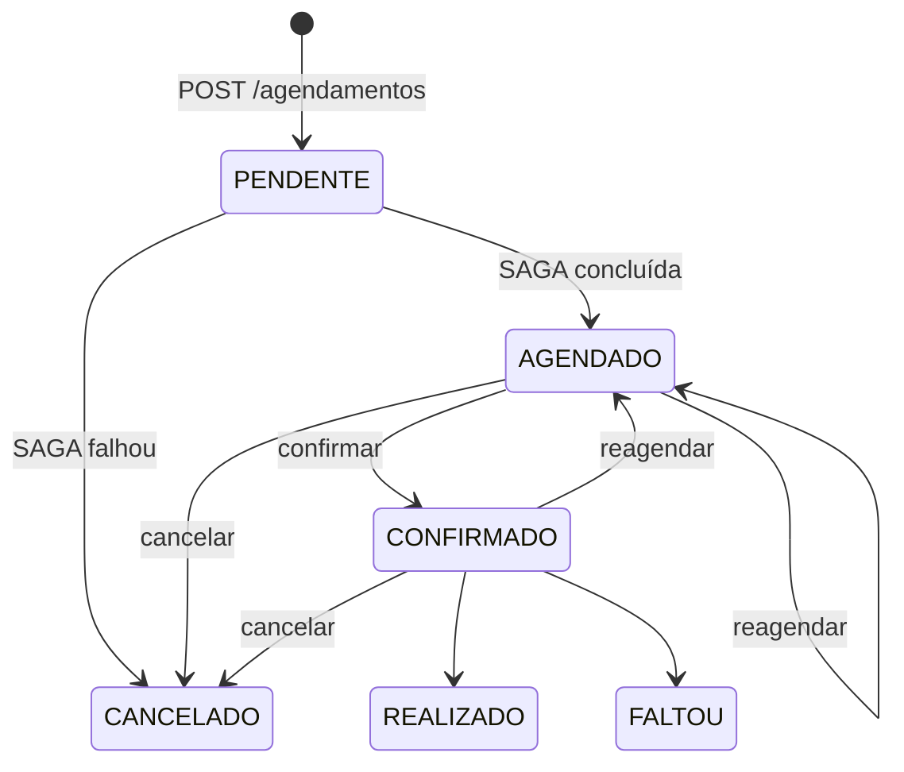

# 📐 API Guidelines — Versionamento, Convenções e HATEOAS

> Complementa os contratos em [`docs/api/`](../api/). O README apresenta apenas a visão geral; aqui estão as regras que todos os 4 serviços seguem.

## 1. Contratos OpenAPI 3.0

| Serviço | Contrato | Banco |
|---------|----------|-------|
| Pacientes | [`openapi-pacientes.yaml`](../api/openapi-pacientes.yaml) | PostgreSQL |
| Agendamento | [`openapi-agendamento.yaml`](../api/openapi-agendamento.yaml) | PostgreSQL (write) + Read Model |
| Triagem IA | [`openapi-triagem.yaml`](../api/openapi-triagem.yaml) | MongoDB + ChromaDB |
| Notificações | [`openapi-notificacoes.yaml`](../api/openapi-notificacoes.yaml) | Redis |

**Abordagem *contract-first*:** o YAML é escrito antes do código; é a fonte de verdade para gerar stubs, validar requests no Gateway e documentar (Swagger UI / Redoc).

Todos os contratos incluem, além dos endpoints de negócio, os endpoints **da SAGA** (ação + compensação idempotente):

| Passo | Serviço | Ação | Compensação |
|-------|---------|------|-------------|
| 1 | Triagem | `POST /triagens` | `DELETE /triagens/{id}` |
| 2 | Pacientes | `POST /pacientes/{id}/validacao` | `DELETE /pacientes/{id}/validacao` |
| 3 | Agendamento | `POST /slots/{id}/reserva` | `DELETE /slots/{id}/reserva` |
| 4 | Notificações | `POST /notificacoes` | `DELETE /notificacoes/{id}` |

## 2. Versionamento — URI Pathing

**Decisão:** a versão major vai no caminho: `/api/v{major}/{recurso}`.

```
https://api.saudeconecta.local/api/v1/agendamentos/{id}
```

| Alternativa | Prós | Contras | Veredito |
|-------------|------|---------|----------|
| **URI Path** (`/api/v1/...`) | Visível, cacheável, trivial de rotear no Gateway, fácil de testar no navegador/curl | URL muda entre versões | ✅ **Escolhida** |
| Header (`Accept: ...;v=2`) | URL estável | Invisível, difícil de rotear/cachear, pior depuração | ❌ |
| Query (`?version=2`) | Simples | Polui cache e logs, fácil de esquecer | ❌ |

**Regras**

1. Só a **major** aparece na URL (`v1`, `v2`). Mudanças compatíveis (campo novo opcional, endpoint novo) **não** criam versão.
2. São **breaking changes**: remover/renomear campo, mudar tipo, tornar campo obrigatório, mudar semântica de status code.
3. Versões coexistem; a anterior fica em **deprecação por no mínimo 90 dias**, sinalizada por `Deprecation: true` e `Sunset: <data>`.
4. O **Gateway** roteia por prefixo (`/api/v1/*` → upstream v1), permitindo subir `v2` sem tocar na `v1` (ver [`gateway-routing.md`](../gateway-routing.md)).
5. **Eventos RabbitMQ** têm versão própria no nome/payload (`SlotReservado.v1`), independente da versão REST.

## 3. Convenções gerais

| Tema | Regra |
|------|-------|
| Recursos | Substantivos no plural, `kebab-case`: `/agendamentos`, `/preferencias-notificacao` |
| Ações não-CRUD | Sub-recurso substantivado via `POST`: `/agendamentos/{id}/cancelamento` |
| Campos JSON | `camelCase`; datas em ISO-8601 com fuso; IDs em UUID |
| Paginação | `?page=1&size=20` (máx. 100); resposta `{items, page, size, total}` |
| Erros | **RFC 7807** (`application/problem+json`) com `correlationId` |
| Idempotência | `Idempotency-Key` em `POST` críticos; `DELETE` de compensação sempre idempotente |
| Segurança | `Authorization: Bearer <JWT>`, validado no Gateway |
| Status codes | `200/201/202/204`, `400/401/403/404/409/422`, `429`, `503` |
| Assíncrono | `202 Accepted` + `Location` quando o resultado depende da SAGA |

## 4. HATEOAS em `GET /agendamentos/{id}`

**Por quê?** O estado do agendamento define quais ações são válidas. Em vez de cada cliente (web, admin) reimplementar a máquina de estados, o servidor **diz** o que pode ser feito via `_links` (formato HAL, `application/hal+json`).

### Máquina de estados × links



| Status | `_links` presentes |
|--------|--------------------|
| `PENDENTE` | `self`, `cancelar` |
| `AGENDADO` | `self`, `confirmar`, `reagendar`, `cancelar` |
| `CONFIRMADO` | `self`, `reagendar`, `cancelar` |
| `CANCELADO` · `REALIZADO` · `FALTOU` | `self` |

### Exemplo de resposta

```json
{
  "id": "3fa85f64-5717-4562-b3fc-2c963f66afa6",
  "status": "AGENDADO",
  "pacienteId": "7c9e6679-7425-40de-944b-e07fc1f90ae7",
  "slotId": "9b2d5c1e-0a4f-4c8e-8f35-1d6f2f9a7b10",
  "dataHora": "2026-11-05T09:30:00-03:00",
  "especialidade": "Clínica Geral",
  "classificacaoUrgencia": "AMARELO",
  "_links": {
    "self":      { "href": "/api/v1/agendamentos/3fa85f64-.../", "method": "GET" },
    "confirmar": { "href": "/api/v1/agendamentos/3fa85f64-.../confirmacao",    "method": "POST" },
    "reagendar": { "href": "/api/v1/agendamentos/3fa85f64-.../reagendamento",  "method": "POST" },
    "cancelar":  { "href": "/api/v1/agendamentos/3fa85f64-.../cancelamento",   "method": "POST" }
  }
}
```

**Regras**

- Links são calculados pelo servidor a partir de `status` **e** permissões do usuário (`X-User-Id`/perfil): o gestor pode ter links extras; o paciente não vê `cancelar` de agendamento alheio.
- Clientes **não** montam URLs: apenas seguem `_links`. Se o link não existe, o botão não é exibido.
- Ação inválida chamada diretamente retorna `409 Conflict` (defesa em profundidade).
- Os links apontam para o caminho **externo** (`/api/v1/...`) — o BFF/Gateway reescreve hosts internos.
- Leitura vem do **Read Model** (CQRS, defasagem ≤ 5 s); as ações vão ao **Write Model**.
