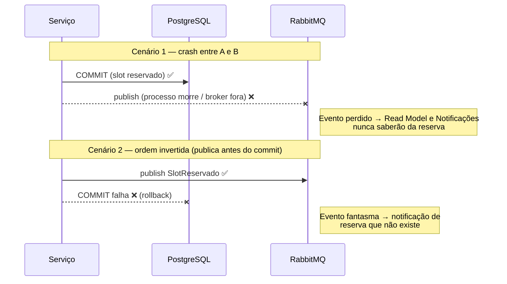
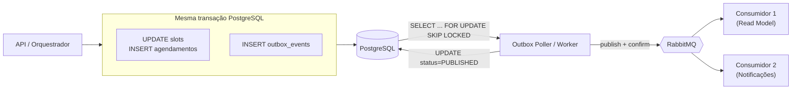

# 📬 Database per Service, Outbox e Dual Write

> O README cita "Database per Service" e "Outbox — publicação confiável de eventos". Aqui está o **problema** (dual write), os **pontos de consistência eventual** e a **modelagem** do Transactional Outbox.

## 1. Consistência eventual — mapa e SLAs

Com *Database per Service* não existe transação distribuída ACID. Cada fronteira abaixo é **eventualmente consistente**:

| # | Origem (verdade) | Destino (cópia/derivado) | Mecanismo | SLA de propagação (p95) | Impacto se atrasar |
|---|------------------|--------------------------|-----------|-------------------------|--------------------|
| 1 | Agendamento (write) | **Read Model** de Agendamento | Evento `SlotReservado` via Outbox | **≤ 5 s** | Paciente vê slot ainda livre; reserva falha com `409` (seguro) |
| 2 | Agendamento | Notificações (lembretes) | `AgendamentoCriado` | ≤ 30 s | Confirmação chega com pequeno atraso |
| 3 | Agendamento | Notificações (cancelamento) | `AgendamentoCancelado` | ≤ 10 s | Risco de lembrete indevido (mitigado: checa estado antes de enviar) |
| 4 | Agendamento | Pacientes (histórico) | `AtendimentoRealizado` | ≤ 60 s | Histórico desatualizado por instantes |
| 5 | Pacientes | Agendamento (dados de exibição) | `PacienteAtualizado` | ≤ 60 s | Nome antigo na tela |
| 6 | Agendamento + Pacientes + Notificações | Dashboard `bff-admin` | Leitura agregada + cache | ≤ 5 min | Indicadores com leve defasagem |
| 7 | Triagem | Agendamento (urgência) | Resposta REST na SAGA (**síncrono**) | — | Consistente por construção |

**O que NÃO pode ser eventual:** a reserva do slot (decidida no write model ACID) — o Read Model nunca é usado para decidir reserva.

**Regras de leitura**

- UI trata `409 Conflict` na reserva como cenário normal e recarrega disponibilidade.
- Toda resposta de leitura inclui o instante da projeção (`atualizadoEm`) para auditoria da defasagem.
- SLA violado dispara alerta (lag do Outbox, ver §4.4).

## 2. O problema do Dual Write

**Dual write** = gravar em dois sistemas (PostgreSQL **e** RabbitMQ) sem uma transação que cubra ambos.

```python
# ❌ Ingênuo
def reservar_slot(cmd):
    with db.transaction():
        slot.reservar(cmd.paciente)
        db.save(slot)          # (A) commit no PostgreSQL
    broker.publish(SlotReservado(...))   # (B) publicação no RabbitMQ
```

### 2.1 Modos de falha



| Ordem | Falha | Resultado | Gravidade |
|-------|-------|-----------|-----------|
| Banco → Broker | Crash/rede após commit | **Evento perdido**: dados divergentes para sempre | 🔴 Alta (silenciosa) |
| Broker → Banco | Rollback após publicar | **Evento fantasma** | 🔴 Alta |
| Publicar dentro da transação | Broker lento segura lock/conexão | Contenção, *timeouts* | 🟠 Média |
| Retry no código da aplicação | Perde-se na queda do processo; pode **duplicar** | Inconsistência | 🟠 Média |

**Por que não 2PC/XA?** RabbitMQ não participa de XA de forma prática; 2PC bloqueia recursos, reduz disponibilidade e acopla os sistemas — contraria o objetivo de microsserviços.

**Conclusão:** é necessário tornar a publicação **atômica com a escrita local**. Solução: **Transactional Outbox**.

## 3. Solução — Transactional Outbox

**Ideia:** em vez de publicar no broker, o serviço grava o evento **na mesma transação ACID** do dado de negócio, em uma tabela `outbox_events`. Um processo separado (*Poller/Worker*) lê a tabela e publica no RabbitMQ, marcando como enviado.



Ou o dado **e** o evento são gravados, ou **nenhum** dos dois. A entrega ao broker passa a ser *at-least-once*, com consumidores idempotentes.

### 3.1 Esquema da tabela `outbox_events` (PostgreSQL)

```sql
CREATE TABLE outbox_events (
    id              UUID         PRIMARY KEY DEFAULT gen_random_uuid(),   -- = eventId
    aggregate_type  VARCHAR(64)  NOT NULL,            -- 'Agendamento'
    aggregate_id    UUID         NOT NULL,            -- id do agregado (chave de ordenação)
    event_type      VARCHAR(96)  NOT NULL,            -- 'SlotReservado'
    event_version   SMALLINT     NOT NULL DEFAULT 1,
    routing_key     VARCHAR(128) NOT NULL,            -- 'agendamento.slot.reservado'
    payload         JSONB        NOT NULL,
    headers         JSONB        NOT NULL DEFAULT '{}'::jsonb,  -- correlationId, traceparent
    status          VARCHAR(16)  NOT NULL DEFAULT 'PENDING'
                    CHECK (status IN ('PENDING','PUBLISHED','FAILED')),
    attempts        INTEGER      NOT NULL DEFAULT 0,
    last_error      TEXT,
    created_at      TIMESTAMPTZ  NOT NULL DEFAULT now(),
    next_attempt_at TIMESTAMPTZ  NOT NULL DEFAULT now(),
    published_at    TIMESTAMPTZ
);

-- Índice parcial: o poller só olha o que está pendente (tabela pequena e rápida)
CREATE INDEX idx_outbox_pending
    ON outbox_events (next_attempt_at, created_at)
    WHERE status = 'PENDING';

CREATE INDEX idx_outbox_aggregate ON outbox_events (aggregate_id, created_at);
```

| Coluna | Para quê |
|--------|----------|
| `id` | Vira `eventId` no envelope; chave de **idempotência** no consumidor |
| `aggregate_id` | Garante **ordem por agregado** (eventos do mesmo agendamento saem em sequência) |
| `event_type` + `event_version` | Evolução de contrato sem quebrar consumidores |
| `routing_key` | Roteamento no *topic exchange* |
| `payload` (JSONB) | Corpo do evento |
| `headers` | `correlationId` (vem do Gateway) para rastrear |
| `status`, `attempts`, `next_attempt_at`, `last_error` | Controle de retry e *backoff* |
| `published_at` | Auditoria e limpeza |

**Exemplo — `SlotReservado.v1`**

```sql
BEGIN;
  UPDATE slots SET status='RESERVADO' WHERE id=:slot AND status='LIVRE';  -- 0 linhas → 409
  INSERT INTO agendamentos (...) VALUES (...);
  INSERT INTO outbox_events (aggregate_type, aggregate_id, event_type, routing_key, payload, headers)
  VALUES ('Agendamento', :agId, 'SlotReservado', 'agendamento.slot.reservado',
          '{"agendamentoId":"...","slotId":"...","pacienteId":"...","dataHora":"2026-11-05T09:30:00-03:00"}',
          '{"correlationId":"..."}');
COMMIT;
```

> Nos serviços com MongoDB/Redis, o equivalente é uma coleção/stream `outbox_events` na mesma unidade atômica do banco (transação multi-documento no Mongo). Hoje apenas **Agendamento** (e Pacientes) publicam eventos críticos, ambos em PostgreSQL.

### 3.2 Dinâmica do Poller/Worker

```mermaid
sequenceDiagram
    participant W as Poller
    participant DB as PostgreSQL
    participant MQ as RabbitMQ
    loop a cada 500 ms (ou LISTEN/NOTIFY)
      W->>DB: BEGIN; SELECT * FROM outbox_events<br/>WHERE status='PENDING' AND next_attempt_at<=now()<br/>ORDER BY created_at LIMIT 100<br/>FOR UPDATE SKIP LOCKED
      DB-->>W: lote de eventos
      loop cada evento
        W->>MQ: publish (persistent, mandatory) + aguarda publisher confirm
        alt ack do broker
          W->>DB: UPDATE status='PUBLISHED', published_at=now()
        else nack / timeout
          W->>DB: attempts+1, next_attempt_at = now()+backoff, last_error
        end
      end
      W->>DB: COMMIT
    end
```

| Aspecto | Decisão |
|---------|---------|
| Leitura | `FOR UPDATE SKIP LOCKED` → várias réplicas do worker sem processar o mesmo evento |
| Frequência | *Polling* a cada **500 ms** (+ `LISTEN/NOTIFY` opcional para reduzir latência) |
| Lote | 100 eventos por ciclo |
| Confiabilidade | *Publisher confirms* + mensagens `persistent` + filas duráveis |
| Retry | Backoff exponencial: 1 s, 2 s, 4 s … até 5 min; após **10 tentativas** → `FAILED` + alerta |
| Ordenação | Por `created_at` dentro do lote; ordem por agregado preservada com `aggregate_id` como chave |
| Entrega | *At-least-once* (publicou mas caiu antes do UPDATE → reenvia) |
| Limpeza | Job diário remove `PUBLISHED` com mais de 7 dias |
| Latência esperada | p95 ≈ 0,5–1 s (consistente com o SLA ≤ 5 s) |

### 3.3 Idempotência no consumidor

Como a entrega pode duplicar, cada consumidor mantém:

```sql
CREATE TABLE processed_events (
    event_id     UUID PRIMARY KEY,
    consumer     VARCHAR(64) NOT NULL,
    processed_at TIMESTAMPTZ NOT NULL DEFAULT now()
);
```

Fluxo: `INSERT ... ON CONFLICT DO NOTHING` na **mesma transação** que aplica o efeito; se o insert não inseriu nada → duplicado, descartar (`ack`).

### 3.4 Observabilidade

| Métrica | Alerta |
|---------|--------|
| `outbox_pending_count` | > 1000 por 1 min |
| `outbox_oldest_pending_age_seconds` | **> 5 s** (violação do SLA do Read Model) |
| `outbox_failed_count` | > 0 |
| `consumer_dlq_depth` | > 0 |

## 4. Trade-offs

| Prós | Contras |
|------|---------|
| Elimina perda e eventos fantasma | Latência extra (~poucas centenas de ms) |
| Sem dependência de 2PC | Tabela e worker adicionais para operar |
| Dado + evento atômicos | Entrega *at-least-once* → exige idempotência |
| Retry e auditoria nativos | Crescimento da tabela → exige limpeza |

**Alternativa considerada:** *CDC com Debezium* (lê o WAL do PostgreSQL). Menos latência e sem polling, porém adiciona Kafka Connect/infra pesada; fica como **evolução futura**.

> Uso do Outbox no CQRS: [`cqrs-agendamento.md`](../arquitetura/cqrs-agendamento.md). Decomposição: [`decomposicao-microsservicos.md`](../arquitetura/decomposicao-microsservicos.md).
