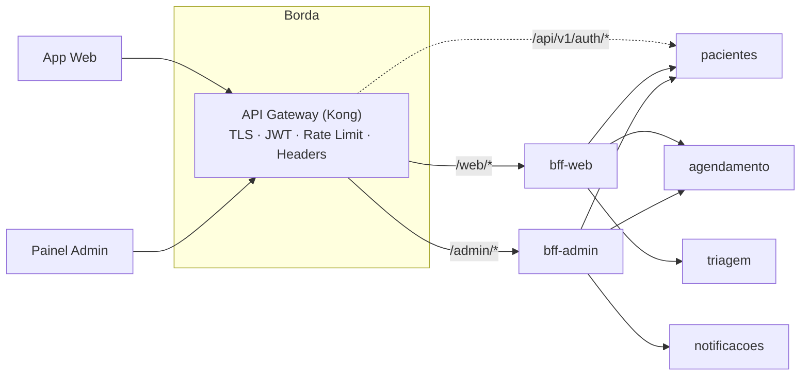
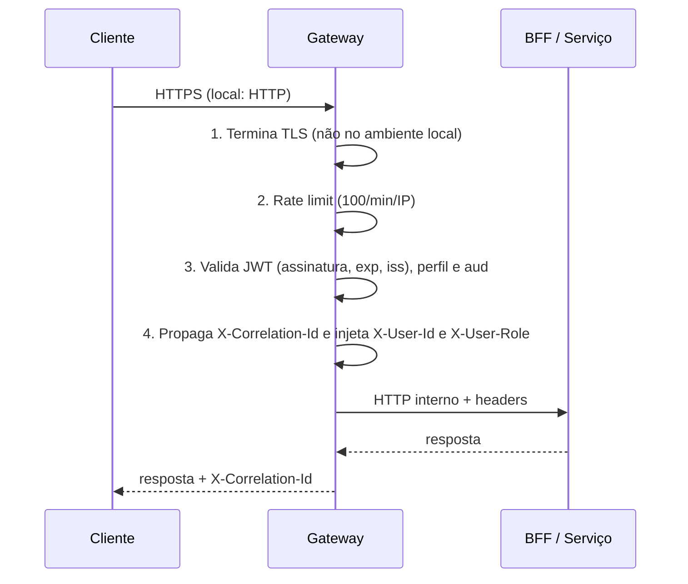

# 🚪 API Gateway — Roteamento e Políticas

> O README resume o Gateway em uma linha ("entrada única, autenticação, rate limiting e roteamento"). Este documento detalha **como** isso é configurado. Tecnologia: **Kong** 3.9.1, sem banco.

## 1. Topologia



Os clientes **só** enxergam o Gateway. Serviços de domínio e BFFs ficam em rede interna, sem porta publicada.

## 2. Tabela de roteamento

| URL externa (`https://api.saudeconecta.local`) | Upstream interno | Porta | Auth | Cliente |
|-----------------------------------------------|------------------|-------|------|---------|
| `POST /api/v1/auth/login` | `pacientes:8001` | 8001 | ❌ pública | Web |
| `POST /api/v1/pacientes` (cadastro) | `pacientes:8001` | 8001 | ❌ pública | Web |
| `/web/v1/*` | `bff-web:3001` | 3001 | ✅ JWT (perfil `paciente`) | Web |
| `/admin/v1/*` | `bff-admin:3002` | 3002 | ✅ JWT (perfil `gestor`) | Admin |
| `GET/PUT /api/v1/pacientes/{id}`, `GET .../historico` | `pacientes:8001` | 8001 | ✅ JWT | Ambos |
| `GET /api/v1/pacientes`, `/pacientes/estatisticas` | `pacientes:8001` | 8001 | ✅ JWT (`gestor`) | Admin |
| `/api/v1/agendamentos`, `/{id}` e ações, `/sagas/{id}`, `/slots`, `/ubs`, `/profissionais` | `agendamento:8002` | 8002 | ✅ JWT | Ambos |
| `/api/v1/escalas`, `/relatorios/ocupacao`, `/agendamentos/{id}/comparecimento` | `agendamento:8002` | 8002 | ✅ JWT (`gestor`) | Admin |
| `POST /api/v1/triagens/recomendacoes`, `GET /triagens`, `/{id}`, `/{id}/orientacoes` | `triagem:8003` | 8003 | ✅ JWT | Ambos |
| `/api/v1/triagens/saude-llm`, `/{id}/feedback` | `triagem:8003` | 8003 | ✅ JWT (`gestor`) | Admin |
| `GET /api/v1/notificacoes`, `/{id}` | `notificacoes:8004` | 8004 | ✅ JWT | Ambos |
| `GET /api/v1/notificacoes/alertas` | `notificacoes:8004` | 8004 | ✅ JWT (`gestor`) | Admin |
| `GET/PUT /api/v1/pacientes/{id}/preferencias-notificacao` | `notificacoes:8004` | 8004 | ✅ JWT | Ambos |
| `/health` | o próprio gateway | — | ❌ pública | Operação |

**Lista do que entra:** rota que não está na tabela responde `404`. Os passos da SAGA (`POST /triagens`, `POST /notificacoes`, `/pacientes/{id}/validacao`), `/metricas` e `/ready` só existem na rede interna.

**Regras de roteamento**

- Roteamento por **prefixo de path** (inclui a major: `/api/v1`, `/api/v2` → upstreams distintos). Ver [`api-guidelines.md`](decisoes-tecnicas/api-guidelines.md).
- **Precedência:** `/api/v1/pacientes/{id}/preferencias-notificacao` pertence ao serviço de **Notificações** (dono das preferências de canal), embora o caminho comece com `/pacientes`. A rota usa *regex* com `regex_priority` maior e é avaliada antes do prefixo genérico `/api/v1/pacientes` → `pacientes`.
- `strip_path=false`: o serviço recebe o caminho completo, mantendo paridade com o OpenAPI.
- `/web/*` e `/admin/*` são rotas separadas porque os BFFs têm perfis distintos (ver [`bff-comparativo.md`](bff-comparativo.md)).
- Chamadas `/api/v1/*` diretas por clientes externos são limitadas a recursos que o perfil permite (ACL por rota/claim); o caminho preferencial é via BFF.

### Configuração

A configuração completa é declarativa e fica em [`gateway/kong.yml`](../gateway/kong.yml) (Kong 3.9.1 sem banco, API de administração desligada). Trecho:

```yaml
consumers:
  - username: paciente
    acls: [{ group: paciente }]
    jwt_secrets: [{ key: saudeconecta-paciente, algorithm: RS256, rsa_public_key: ... }]  # key = iss
plugins:                      # em toda requisição
  - name: correlation-id
  - name: limite-antes        # rate-limiting do Kong, com prioridade acima do JWT
    config: { minute: 100, limit_by: ip, policy: redis, fault_tolerant: true }
  - name: identidade          # descarta X-User-* do cliente e injeta os do token
services:
  - name: bff-web
    routes:
      - { name: bff-web, paths: [/web/v1], strip_path: true, plugins: [jwt, acl: paciente] }
```

**Dois plugins próprios**, pequenos, em [`gateway/plugins`](../gateway/plugins):

| Plugin | Por quê |
|--------|---------|
| `limite-antes` | No Kong, o `jwt` (prioridade 1450) roda antes do `rate-limiting` (910), e token inválido não gastaria cota. É o mesmo limitador registrado com prioridade 2000; reordenar plugins por configuração é recurso pago |
| `identidade` | O Kong gratuito não confere `aud` nem injeta o `sub`. Também põe os erros do gateway no formato RFC 7807 |

## 3. Responsabilidades cross-cutting



A ordem importa: **rate limit antes do JWT** protege a validação criptográfica contra abuso; token inválido já consome cota do IP.

### 3.1 Terminação TLS

| Item | Decisão |
|------|---------|
| Versão | TLS 1.2 mínimo, 1.3 preferido |
| Certificado | Let's Encrypt (prod) / autoassinado (local) |
| Redirecionamento | HTTP 80 → HTTPS 443 (`301`) + HSTS |
| Ambiente local | **TLS não habilitado**: a demonstração usa HTTP em `localhost` |
| Tráfego interno | HTTP puro na rede privada do cluster (mTLS fica como evolução, via service mesh) |

*Por quê:* centraliza certificados em um ponto e poupa CPU dos serviços.

### 3.2 Rate Limiting — 100 req/min por IP

| Item | Valor |
|------|-------|
| Limite | **100 requisições / minuto / IP** |
| Janela | Fixa de 60 s, contador em **Redis** (consistente entre réplicas do Gateway) |
| Excedido | `429 Too Many Requests` + `Retry-After` (RFC 7807) |
| Cabeçalhos | `X-RateLimit-Limit-Minute`, `X-RateLimit-Remaining-Minute`, `RateLimit-Reset` |
| Falha do Redis | `fault_tolerant`: libera (disponibilidade > limite) |
| IP real | Lido de `X-Forwarded-For` somente de proxies confiáveis (no Kubernetes, a rede de pods) |

*Limitações conhecidas:* usuários atrás de NAT (UBS com IP compartilhado) dividem a cota; evolução possível: limite por `X-User-Id` após autenticação. O contador é somado depois de cada resposta, então uma rajada simultânea pode passar um pouco do limite. No Docker Compose, todas as máquinas que acessam a porta publicada podem aparecer com o mesmo IP.

### 3.3 Validação de JWT

| Verificação | Detalhe |
|-------------|---------|
| Assinatura | RS256; chave pública gerada na instalação e montada no Gateway |
| Claims | `exp` (obrigatório; expirado → `401`), `iss`, `aud`, `sub` (UUID). Token só no cabeçalho `Authorization`, nunca na URL |
| Perfil | definido pelo emissor (`saudeconecta-paciente` ou `saudeconecta-gestor`), que escolhe o consumidor no Kong; confrontado com a rota (`/admin/*` exige `gestor`, senão `403`) |
| Emissão | Serviço de **Pacientes** (`POST /auth/login`); o Gateway só **valida** |
| Rotas públicas | login e cadastro |

### 3.4 Propagação de headers

| Header | Origem | Uso |
|--------|--------|-----|
| `X-User-Id` | Claim `sub` do JWT, injetado pelo Gateway | Identificar o usuário sem reparsear o token; autorização por dono do recurso |
| `X-User-Role` | Consumidor do Kong, a partir do `iss` | Autorização por perfil. O valor `servico` só existe na rede interna (passos da SAGA); o gateway nunca o emite |
| `X-Correlation-Id` | Gerado (UUID) se ausente; preservado se enviado | Rastrear a requisição ponta a ponta e a SAGA (logs, eventos RabbitMQ) |
| `Authorization` | — | Removido no Gateway: o token não circula na rede interna |

**Regras de segurança**

- O Gateway **remove** `X-User-Id`/`X-User-Role` vindos do cliente antes de injetar os seus (evita spoofing).
- Serviços **confiam** nesses headers apenas por estarem em rede interna isolada. No Kubernetes, uma NetworkPolicy impede contornar o gateway.
- Cada serviço ainda confere o dono do recurso, e cada BFF confere o perfil.
- BFFs e serviços **reenviam** `X-Correlation-Id` em toda chamada HTTP e o incluem no envelope das mensagens RabbitMQ.

## 4. Prova

```bash
scripts/verificar_gateway.sh   # ~3 min, na stack real, só pela porta publicada
```

Cobre token sem assinatura, adulterado, expirado, de outra chave ou de outro público, HS256 com a chave pública, perfil por rota, cabeçalho forjado, rotas internas, limite de requisições e o fluxo completo pelos BFFs.

Os dois clientes são servidos pelo mesmo gateway (mesma origem), por isso não há CORS.
