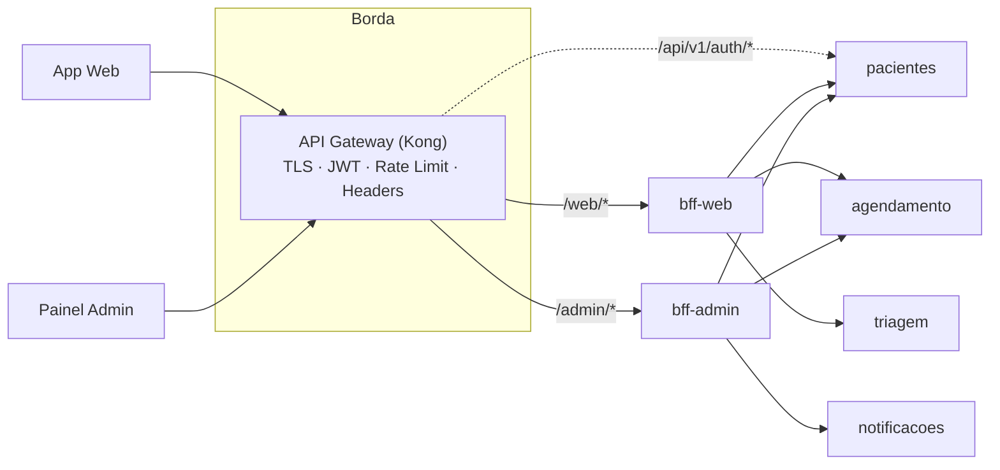
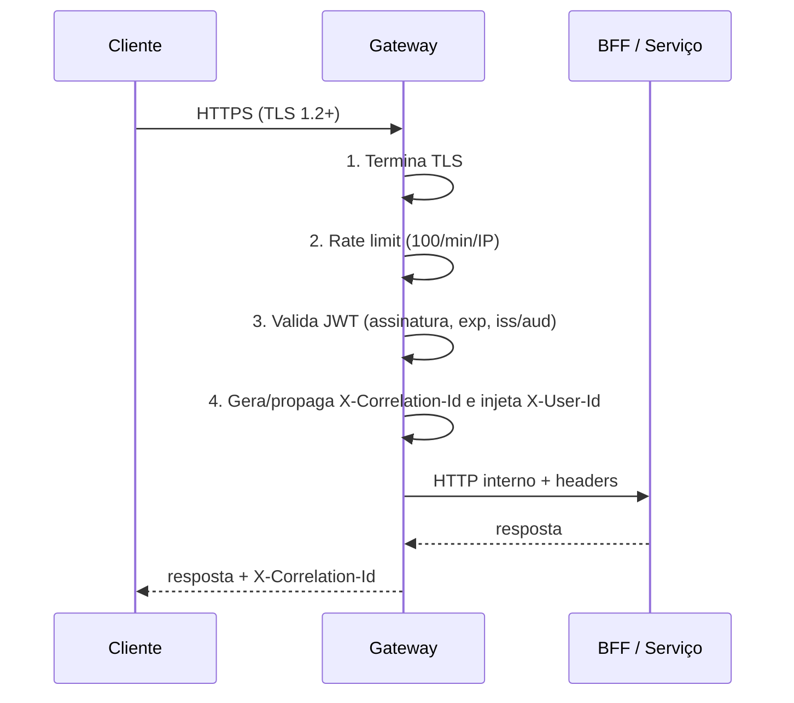

# 🚪 API Gateway — Roteamento e Políticas

> O README resume o Gateway em uma linha ("entrada única, autenticação, rate limiting e roteamento"). Este documento detalha **como** isso é configurado. Tecnologia: **Kong** (alternativa equivalente: NGINX + `lua-resty-jwt`).

## 1. Topologia



Os clientes **só** enxergam o Gateway. Serviços de domínio e BFFs ficam em rede interna, sem porta publicada.

## 2. Tabela de roteamento

| URL externa (`https://api.saudeconecta.local`) | Upstream interno | Porta | Auth | Cliente |
|-----------------------------------------------|------------------|-------|------|---------|
| `/api/v1/auth/login` | `pacientes:8001` | 8001 | ❌ pública | Web |
| `POST /api/v1/pacientes` (cadastro) | `pacientes:8001` | 8001 | ❌ pública | Web |
| `/web/v1/*` | `bff-web:3001` | 3001 | ✅ JWT (perfil `paciente`) | Web |
| `/admin/v1/*` | `bff-admin:3002` | 3002 | ✅ JWT (perfil `gestor`) | Admin |
| `/api/v1/pacientes/*` | `pacientes:8001` | 8001 | ✅ JWT | Interno/BFF |
| `/api/v1/agendamentos/*`, `/slots/*`, `/escalas/*`, `/relatorios/*` | `agendamento:8002` | 8002 | ✅ JWT | Interno/BFF |
| `/api/v1/triagens/*` | `triagem:8003` | 8003 | ✅ JWT | Interno/BFF |
| `/api/v1/notificacoes/*` | `notificacoes:8004` | 8004 | ✅ JWT | Interno/BFF |
| `/api/v1/pacientes/{id}/preferencias-notificacao` | `notificacoes:8004` | 8004 | ✅ JWT | Interno/BFF |
| `/docs/{servico}` | Swagger UI estático | — | ✅ (apenas dev/stg) | Dev |

> Os rótulos de porta são convenções do projeto (a ser fixadas no Docker Compose da Parte 3).

**Regras de roteamento**

- Roteamento por **prefixo de path** (inclui a major: `/api/v1`, `/api/v2` → upstreams distintos). Ver [`api-guidelines.md`](decisoes-tecnicas/api-guidelines.md).
- **Precedência:** `/api/v1/pacientes/{id}/preferencias-notificacao` pertence ao serviço de **Notificações** (dono das preferências de canal), embora o caminho comece com `/pacientes`. A rota usa *regex* com `regex_priority` maior e é avaliada antes do prefixo genérico `/api/v1/pacientes` → `pacientes`.
- `strip_path=false`: o serviço recebe o caminho completo, mantendo paridade com o OpenAPI.
- `/web/*` e `/admin/*` são rotas separadas porque os BFFs têm perfis distintos (ver [`bff-comparativo.md`](bff-comparativo.md)).
- Chamadas `/api/v1/*` diretas por clientes externos são limitadas a recursos que o perfil permite (ACL por rota/claim); o caminho preferencial é via BFF.

### Exemplo de configuração declarativa (Kong, trecho)

```yaml
_format_version: "3.0"
services:
  - name: agendamento
    url: http://agendamento:8002
    routes:
      - name: agendamento-v1
        paths: [/api/v1/agendamentos, /api/v1/slots, /api/v1/escalas, /api/v1/relatorios]
        strip_path: false
  - name: notificacoes
    url: http://notificacoes:8004
    routes:
      - name: notificacoes-preferencias-v1
        paths: ["~/api/v1/pacientes/[^/]+/preferencias-notificacao$"]
        regex_priority: 10        # vence o prefixo /api/v1/pacientes
        strip_path: false
      - name: notificacoes-v1
        paths: [/api/v1/notificacoes]
        strip_path: false
  - name: bff-web
    url: http://bff-web:3001
    routes:
      - { name: bff-web, paths: [/web/v1], strip_path: true }
  - name: bff-admin
    url: http://bff-admin:3002
    routes:
      - { name: bff-admin, paths: [/admin/v1], strip_path: true }
plugins:
  - name: rate-limiting
    config: { minute: 100, policy: redis, limit_by: ip, fault_tolerant: true, hide_client_headers: false }
  - name: jwt
    config: { claims_to_verify: [exp] }
  - name: correlation-id
    config: { header_name: X-Correlation-Id, generator: uuid, echo_downstream: true }
```

## 3. Responsabilidades cross-cutting



A ordem importa: **rate limit antes do JWT** protege a validação criptográfica contra abuso; token inválido já consome cota do IP.

### 3.1 Terminação TLS

| Item | Decisão |
|------|---------|
| Versão | TLS 1.2 mínimo, 1.3 preferido |
| Certificado | Let's Encrypt (prod) / autoassinado (local) |
| Redirecionamento | HTTP 80 → HTTPS 443 (`301`) + HSTS |
| Tráfego interno | HTTP puro na rede privada do cluster (mTLS fica como evolução, via service mesh) |

*Por quê:* centraliza certificados em um ponto e poupa CPU dos serviços.

### 3.2 Rate Limiting — 100 req/min por IP

| Item | Valor |
|------|-------|
| Limite | **100 requisições / minuto / IP** |
| Janela | Fixa de 60 s, contador em **Redis** (consistente entre réplicas do Gateway) |
| Excedido | `429 Too Many Requests` + `Retry-After` (RFC 7807) |
| Cabeçalhos | `X-RateLimit-Limit`, `X-RateLimit-Remaining` |
| Falha do Redis | `fault_tolerant`: libera (disponibilidade > limite) |
| IP real | Lido de `X-Forwarded-For` somente de proxies confiáveis |

*Limitação conhecida:* usuários atrás de NAT (UBS com IP compartilhado) dividem a cota; evolução possível: limite por `X-User-Id` após autenticação.

### 3.3 Validação de JWT

| Verificação | Detalhe |
|-------------|---------|
| Assinatura | RS256; chave pública configurada no Gateway (JWKS) |
| Claims | `exp` (expirado → `401`), `iss`, `aud`, `sub` |
| Perfil | claim `role` (`paciente` \| `gestor`) confrontada com a rota (`/admin/*` exige `gestor`, senão `403`) |
| Emissão | Serviço de **Pacientes** (`POST /auth/login`); o Gateway só **valida** |
| Rotas públicas | login e cadastro |

### 3.4 Propagação de headers

| Header | Origem | Uso |
|--------|--------|-----|
| `X-User-Id` | Claim `sub` do JWT, injetado pelo Gateway | Identificar o usuário sem reparsear o token; autorização por dono do recurso |
| `X-User-Role` | Claim `role` | Autorização por perfil |
| `X-Correlation-Id` | Gerado (UUID) se ausente; preservado se enviado | Rastrear a requisição ponta a ponta e a SAGA (logs, eventos RabbitMQ) |
| `Authorization` | Original | Repassado para chamadas serviço-a-serviço quando necessário |

**Regras de segurança**

- O Gateway **remove** `X-User-Id`/`X-User-Role` vindos do cliente antes de injetar os seus (evita spoofing).
- Serviços **confiam** nesses headers apenas por estarem em rede interna isolada.
- BFFs e serviços **reenviam** `X-Correlation-Id` em toda chamada HTTP e o incluem no envelope das mensagens RabbitMQ.
